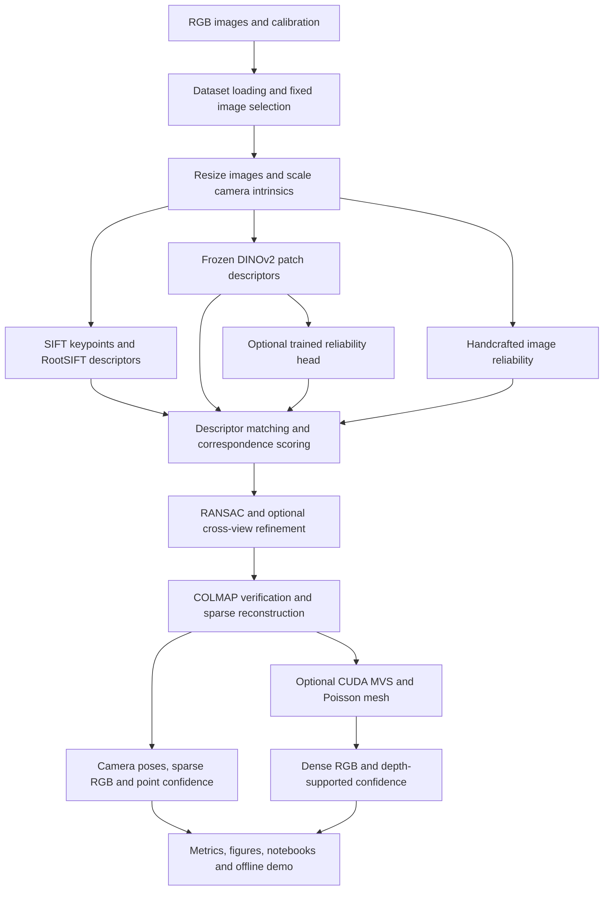

# Visibility-Aware Underwater 2D–3D Reconstruction

## Detailed project summary

**Snapshot:** 7 October 2026  
**Package:** `underwater-vision`, version `0.1.0`  
**Code baseline:** `06288de`, following the fifteen-commit publication  
**Language:** English  
**Evidence:** current source code, configuration files, dataset inventory, saved experiment metrics, training records and publication checks.

This document explains the project as a research and engineering system. It connects the original objectives to the implemented pipeline, describes its inputs and outputs, presents measured results, and identifies the work needed before a full-scene benchmark.

## 1. Project purpose and current maturity

The project reconstructs an underwater archaeological scene from overlapping RGB photographs captured by a moving camera. Its central research question is:

> How can local image visibility and feature reliability help multi-view reconstruction when underwater images contain weak texture, blur, uneven illumination and color degradation?

The implemented system combines classical local features, frozen foundation-model descriptors, image-quality cues and multi-view geometric evidence. Reliability affects correspondence scores, filtering and geometric verification. The resulting correspondence graph enters COLMAP for camera estimation and reconstruction. Additional confidence fields describe the observational support for reconstructed 3D points.

The project currently has a working research prototype, a complete local Mermaid dataset, real sparse and dense reconstruction artifacts, a trained reliability head, controlled development comparisons, tests and English documentation. The measured comparison covers one 16-image block. Full-scene evaluation across all 1,244 images, repeated seeds and independently validated geometric accuracy remain research work.

| Area | Current state |
| --- | --- |
| Dataset acquisition | Complete locally; 1,244 original RGB images and 1,244 published reference poses |
| Classical and hybrid feature pipelines | Implemented and exercised on real images |
| Handcrafted and learned reliability | Implemented; weak supervision and inference checks are available |
| Sparse reconstruction | Successful for all six selected classical/hybrid development variants |
| Dense reconstruction | Successful for the classical and handcrafted-visibility development runs |
| Evaluation and ablations | Measured on a fixed 16-image development block |
| Engineering validation | Last publication checks passed 26 tests, lint, formatting and package building |
| Full-scene research benchmark | Pending |
| Semantic/object interpretation | Optional specification objective; implementation pending |

## 2. Original scope and implemented deliverables

The original specification asks for visibility-aware 2D representations, robust correspondences, camera poses, sparse and dense geometry, colored point clouds or meshes, reconstruction confidence and quantitative baseline comparisons. It also includes optional semantic understanding of archaeological objects.

| Original deliverable | Implemented form | Evidence or qualification |
| --- | --- | --- |
| Visibility-aware 2D representation | RootSIFT, DINOv2 descriptors, local reliability and optional repeatability | Feature caches, visibility figures and matching results |
| Robust cross-view correspondences | Mutual ratio matching, score filtering and geometric verification | Saved pair arrays and pair-level metrics |
| Camera poses / trajectory | COLMAP camera estimation and exported camera-to-world transforms | `camera_poses.json` in successful runs |
| Sparse 3D reconstruction | Triangulated COLMAP tracks and colored points | Sparse model, RGB PLY and confidence exports |
| Dense 3D reconstruction | CUDA COLMAP PatchMatch and stereo fusion | Dense clouds and depth/normal maps for two selected runs |
| Colored point cloud / mesh | PLY point clouds and Poisson meshes | Nonempty dense clouds and meshes were produced |
| Reconstruction confidence | Sparse track confidence and dense depth-supported confidence | Confidence fields in PLY/NPZ and JSON diagnostics |
| Quantitative baseline comparison | Classical, hybrid neural, visibility, consistency, learned and backbone variants | Fixed-input development comparison tables |
| Semantic/object understanding | Future extension | No verified segmentation or object labels are generated |

The project's custom work sits in the feature, reliability, correspondence and confidence layers. COLMAP supplies standard geometric reconstruction machinery. Its bundle adjustment and PatchMatch objectives retain their standard behavior.

## 3. Input and output contract

### 3.1 Inputs

| Input | Purpose | Requirement |
| --- | --- | --- |
| Overlapping underwater RGB photographs | Supply texture and cross-view observations | Required; at least two images for feature/matching stages, with sufficient overlap and baseline for reconstruction |
| Camera calibration | Defines scaled intrinsics and lens distortion | Required by the current Mermaid configuration |
| Ordered image selection | Freezes the acquisition views used by an experiment | Supports start/count/stride or an explicit filename list |
| Hydra configuration | Selects descriptors, reliability, matching and reconstruction settings | Required through the experiment entry point |
| Published reference camera poses | Support trajectory comparison | Optional for the reconstruction itself; available for all local Mermaid frames |
| Official pretrained DINOv2 weights | Supply frozen neural patch descriptors | Required for hybrid and learned variants |
| Reliability checkpoint | Predicts learned keypoint reliability | Required for the learned variant |
| CUDA-enabled COLMAP executable | Runs dense PatchMatch, fusion and meshing | Required when dense reconstruction is requested |

The pipeline uses monocular observations from the dataset's camera sequence. It does not require labeled archaeological objects or an independently surveyed dense surface to reconstruct a scene. Those additional references would be needed for semantic evaluation or independent dense accuracy measurements.

### 3.2 Outputs

| Output | Representation | Interpretation |
| --- | --- | --- |
| Resized images | JPEG images and preprocessing manifests | Development images with recorded scaling |
| Localized features | NPZ arrays containing coordinates and descriptors | SIFT localization with RootSIFT and optional DINOv2 information |
| Reliability evidence | Maps, sampled feature scores and figures | Handcrafted image evidence or learned geometric reliability |
| Correspondences | Candidate indices, scores, inlier masks, errors and fundamental matrices | Pairwise matching and geometric verification results |
| Camera trajectory | JSON camera-to-world matrices and COLMAP model | Estimated camera geometry |
| Sparse geometry | RGB PLY, COLMAP model and confidence NPZ/PLY | Triangulated feature tracks |
| Dense geometry | Fused RGB PLY, geometric depth/normal maps and mesh | MVS output when requested |
| Point confidence | Scalar confidence, source support and diagnostics | Heuristic evidence about reconstruction support |
| Evaluation | JSON metrics, comparison tables and plots | Development measurements and reference agreement |
| Reproducibility records | Resolved YAML, input/cache manifests, status and optional MLflow artifacts | Traceable configuration, inputs and failures |
| Inspection tools | Five notebooks, Open3D viewer and offline interactive HTML | Exploration of saved data and reconstructions |

Outputs depend on the selected stage and its success. A feature-only run stops before correspondence estimation. A matching run stops before SfM. Dense artifacts appear when dense reconstruction is requested and completes successfully.

## 4. Dataset, provenance and reference geometry

The implementation uses the official Mermaid underwater dataset described by EPITA/LRE and distributed through SEANOE. Dataset provenance, source identifiers and license information are preserved in the local metadata and in [docs/dataset.md](docs/dataset.md).

### 4.1 Verified local inventory

| Item | Recorded value |
| --- | ---: |
| RGB JPEG images | 1,244 |
| Published reference camera poses | 1,244 |
| Images associated with reference poses | 1,244 |
| Original image resolution | 3,840 × 2,880 pixels |
| Original image channels | 3, RGB |
| Image archive size | 3,690,513,210 bytes |
| Total extracted JPEG bytes | 3,694,287,387 bytes |
| Extracted images with matching archive size and CRC | 1,244 |

The full image ZIP previously passed archive CRC validation. The downloader records local SHA-256 hashes, checks expected file sizes, supports HTTP range resume and protects extraction paths. Local hashes document downloaded-file integrity; publisher-supplied cryptographic checksums are a separate provenance question.

The asset set includes acquisition/calibration PDFs, a reference-pose XML file, a GCP-network STL and the original image ZIP. The loader matches XML camera labels to image filename stems, validates transform structure and excludes hidden/macOS metadata files.

Public descriptions and acquisition documentation contain differing image counts, resolutions and size estimates. This summary uses the verified local inventory rather than assuming the larger overview figures in the original specification.

### 4.2 Meaning of the reference assets

Published camera poses were estimated through multi-view bundle adjustment. Comparing reconstructed trajectories with these poses measures agreement with an existing photogrammetric solution. Independent camera ground truth would require additional validation.

The STL represents the micro-geodesic ground-control network. It does not provide a surveyed dense surface of the underwater scene. Consequently, the current project reports dense cloud size, observation support and visual inspection; independent dense surface accuracy, completeness, Chamfer distance and F-score remain unavailable.

The code is under the MIT license. The dataset license recorded in its inventory is CC BY-NC-ND 4.0. Dataset and pretrained-model terms are separate from the repository's code license.

## 5. End-to-end architecture



The neural and reliability branches depend on the experiment configuration. The classical baseline uses RootSIFT and ordinary verification. Hybrid variants add DINOv2 information; reliability variants also modify correspondence scores and confidence-based geometric selection.

## 6. Methods implemented in the pipeline

### 6.1 Image preprocessing and coordinate conventions

The standard development resolution has a longest edge of 960 pixels, converting a 3,840 × 2,880 image to 960 × 720. Resize operations preserve aspect ratio and return exact horizontal/vertical scale factors. Optional CLAHE enhancement is available and disabled in the default configuration.

The Mermaid calibration is transcribed from the acquisition PDF and interpreted as a Brown distortion model with principal-point offsets relative to the image center. The configuration stores focal length `2334.29`, center offsets `-12.752` and `-16.6962`, three radial coefficients and two tangential coefficients. The model enters COLMAP as `FULL_OPENCV` with zero denominator distortion coefficients.

This interpretation is a documented assumption. Independent verification of the source convention and underwater calibration remains necessary. Development comparisons keep intrinsics fixed by default.

RootSIFT keypoints use OpenCV pixel coordinates. Importing them into COLMAP adds 0.5 pixels to match its pixel-center convention. Custom fundamental-matrix verification uses undistorted coordinates; COLMAP receives the original distorted image coordinates and the configured distortion model.

### 6.2 RootSIFT localization and descriptors

OpenCV SIFT provides keypoint positions and 128-dimensional descriptors. RootSIFT divides each nonnegative SIFT descriptor by its L1 sum and takes the elementwise square root:

```text
d_root = sqrt(d_sift / (sum(d_sift) + epsilon))
```

The requested feature count defaults to 4,096. Empty-feature cases return valid empty arrays. SIFT supplies fine spatial localization for both classical and hybrid variants.

### 6.3 Frozen DINOv2 features

The supported backbones are official DINOv2 B/14 and S/14. Project configurations and the model-download script pin upstream revision `7764ea0f912e53c92e82eb78a2a1631e92725fc8`.

Images receive ImageNet normalization and replicated bottom/right padding to multiples of the 14-pixel patch size. Frozen patch tokens are bilinearly sampled at SIFT locations, then L2-normalized. Inference uses evaluation mode and disabled gradients; CUDA inference supports mixed precision.

The hybrid descriptor is:

```text
d_hybrid = concatenate(sqrt(1 - alpha) * d_root,
                       sqrt(alpha) * d_dino)
alpha = 0.35 by default
```

DINOv2 supplies contextual descriptor information while SIFT supplies localization. The backbone is not fine-tuned. Setting `alpha=1.0` produces the pure-DINO descriptor ablation at the same SIFT keypoint locations.

### 6.4 Matching and confidence scoring

Matching uses L2 nearest-neighbor distances, a ratio test and mutual agreement between both matching directions. The default ratio threshold is 0.8. Pairing follows the ordered sequence and a six-view neighborhood rather than comparing every possible image pair.

The matcher converts descriptor distance into a similarity score. When semantic descriptors are available, it combines that score with normalized DINO cosine similarity. Reliability-aware variants multiply the score by reliability at both endpoints:

```text
score_semantic = (1 - alpha) * score_descriptor
                 + alpha * clip((cosine_dino + 1) / 2, 0, 1)
score_reliable = score_semantic * reliability_a * reliability_b
```

The descriptor score refers to whichever descriptor was matched, including the fused descriptor in hybrid runs. Scores are clipped to `[0, 1]`, and candidates below the default minimum score of 0.08 are discarded before geometric verification.

### 6.5 Handcrafted image reliability

The deterministic estimator measures local evidence using a default 15 × 15 window. Fixed normalization scales preserve the distinction between globally poor and useful images.

| Cue used in the final score | Weight | Evidence represented |
| --- | ---: | --- |
| Local contrast | 0.25 | Intensity variation |
| Laplacian sharpness | 0.25 | Fine structure and blur sensitivity |
| Gradient texture | 0.20 | Local spatial detail |
| Quantized entropy | 0.20 | Local intensity diversity |
| Exposure | 0.08 | Departure from very dark or bright regions |
| Color balance | 0.02 | Channel imbalance |

Saturation is also computed as a diagnostic cue, but it is not included in the final weighted score. Reliability is clipped to `[0, 1]` and interpolated at keypoint positions.

These values express image evidence. They are neither physically calibrated underwater visibility measurements nor probabilities of correct geometry.

### 6.6 Geometric verification and weighted RANSAC

An OpenCV RANSAC fundamental matrix supplies an initial hypothesis. The default custom threshold is 1.5 resized-image pixels, with 600 iterations and seed 42.

Reliability-aware verification additionally samples eight-point hypotheses in proportion to correspondence confidence and scores their weighted inlier support. Normalized weighted eight-point fitting refines the solution and enforces matrix rank two. Verification exports an inlier mask and Sampson-distance errors.

COLMAP subsequently verifies the retained matches independently. Reliability therefore influences the graph supplied to SfM, while COLMAP's bundle adjustment optimizes its standard objective.

### 6.7 Cross-view consistency

The consistency variant accumulates candidate-match observations and geometric successes for each feature. Its Beta-smoothed repeatability estimate is:

```text
repeatability = (successful_observations + prior / 2)
                / (candidate_observations + prior)
prior = 2.0 by default
```

Unobserved features have a neutral repeatability value of 0.5. The second pass updates reliability and correspondence scores using repeatability, then repeats geometric verification. Its supervision comes from first-pass geometry, so incorrect initial geometry can propagate into the update.

### 6.8 Sparse reconstruction

The adapter imports keypoints and surviving matches using PyCOLMAP's database API, performs COLMAP verification and incremental mapping, and selects the model with the largest registered-camera count. It exports camera-to-world poses, sparse RGB geometry, reprojection statistics and track lengths.

The default mapper requests at least 50 initialization inliers, a 4-degree initialization triangulation angle, a minimum model size of three and four processing threads. Initialization requirements and available baseline can still cause a run to fail; saved failure records preserve that outcome.

### 6.9 Dense reconstruction and meshing

Dense reconstruction uses an external CUDA-enabled COLMAP executable. Its sequence is image undistortion, geometric-consistency PatchMatch, stereo fusion and optional Poisson meshing. Individual command logs are retained.

The verified local backend is COLMAP 4.2.1 CUDA. Development dense processing uses a maximum image size of 960. Meshing uses depth 9, trim 0 and four threads, following an earlier empty-mesh failure with stronger trimming. Dense fusion and meshing validate nonempty vertex outputs.

Untrimmed Poisson meshing can close unsupported holes. Mesh appearance and face count therefore need to be interpreted alongside camera support and source observations.

## 7. Learned reliability: training, supervision and separation

The learned component is a small MLP operating on frozen DINOv2 descriptors:

```text
C-dimensional descriptor
    -> Linear(C, C/2)
    -> GELU
    -> Linear(C/2, 1)
    -> sigmoid at inference
```

Training uses `BCEWithLogitsLoss` and AdamW with learning rate `0.001`, weight decay `0.0001` and batches of up to 512 observations. Only the reliability head is optimized.

Targets are soft geometric inlier frequencies for features observed in at least two candidate pairs. Features without sufficient observations are excluded from this supervision. The targets reflect the behavior of the initial matcher and verifier, which introduces selection bias and possible geometric labeling errors.

| Training property | Recorded value |
| --- | --- |
| Training acquisition block | IDs 200, 202, …, 262 |
| Input training views | 32 |
| Frozen backbone | DINOv2 B/14 |
| Training epochs | 20 |
| Total eligible observations | 1,509 |
| Training observations | 1,073 |
| Validation observations | 282 |
| Excluded boundary observations | 154 |
| Best validation BCE | 0.410082 |
| Saved model | `outputs/models/reliability.pt` |
| Training history | `outputs/models/reliability.json` |

Validation uses a contiguous frame-group block, with excluded boundary groups separating training and validation observations. Checkpoints record channel count, backbone, upstream revision, seed and training image names.

At inference, the pipeline checks backbone/revision compatibility, records a checkpoint SHA-256 hash and rejects evaluation images within 20 acquisition IDs of the training block. The selected evaluation IDs 0, 2, …, 30 satisfy this temporal gap.

Temporal separation still needs spatial verification because a camera trajectory can revisit the same area. Validation BCE measures fit to geometric soft labels; independent reconstruction-error calibration would require additional reference evidence.

## 8. Reconstruction confidence

### 8.1 Sparse point confidence

Each sparse point combines four forms of evidence: number of observing views, reprojection error, maximum triangulation angle and mean source-feature reliability.

```text
confidence_sparse = (1 - exp(-max(views - 1, 0) / 3))
                    * exp(-reprojection_error / 2)
                    * (1 - exp(-maximum_angle_degrees / 5))
                    * mean_feature_reliability
```

The implementation clips the result to `[0, 1]`. JSON diagnostics retain point IDs, view counts, angles, reprojection error and confidence. PLY and NPZ exports preserve original coordinates and RGB alongside this evidence score.

### 8.2 Dense point confidence

Dense confidence projects fused points into undistorted cameras and checks their projected depth against geometric MVS depth maps. A view contributes only when the point is in front of the camera, inside the image and within the default 2% relative depth tolerance.

The score combines saturating supported-view count, mean source-image reliability and a penalty for mean relative depth residual:

```text
confidence_dense = (1 - exp(-supported_views / 3))
                   * mean_supported_image_reliability
                   * exp(-mean_relative_depth_residual / 0.02)
```

Points without supporting observations receive zero confidence. `fused_confidence.ply` adds confidence and supporting-view fields to the fused cloud. This dense score uses handcrafted image reliability even when sparse matching uses the learned head.

Calibration of either confidence field against independently measured 3D errors remains future work.

## 9. Evaluation protocol and available metrics

### 9.1 Controlled development selection

The selected comparison uses 16 images with acquisition IDs 0, 2, …, 30. Views are processed at 960 × 720 with seed 42 and shared camera calibration, ratio threshold, pairing window and mapper settings. The six-view neighborhood produces 75 evaluated pairs.

The default configuration selects 24 images unless overridden. The reported 16-image results come from the explicit frozen evaluation list in `configs/evaluation_images.txt`.

| Variant | Local/neural descriptors | Reliability | Custom geometry |
| --- | --- | --- | --- |
| A: classical | RootSIFT | None | Unweighted RANSAC |
| B: neural hybrid | RootSIFT + DINOv2 B/14 | None | Unweighted RANSAC |
| C: visibility | RootSIFT + DINOv2 B/14 | Handcrafted | Weighted RANSAC |
| C2: consistency | RootSIFT + DINOv2 B/14 | Handcrafted + repeatability | Weighted RANSAC and second pass |
| D: learned | RootSIFT + DINOv2 B/14 | Learned MLP | Weighted RANSAC |
| S: small backbone | RootSIFT + DINOv2 S/14 | Handcrafted | Weighted RANSAC |
| B0: pure-DINO descriptor | DINOv2 B/14 at SIFT positions | None | Unweighted RANSAC |

### 9.2 Metric definitions and practical meaning

| Metric family | Measurements | Interpretation |
| --- | --- | --- |
| Correspondence | Candidate matches, geometric inliers and inlier ratio | Agreement with the custom geometric verifier |
| Pair connectivity | Fraction of pairs with at least 15 accepted inliers | Code-defined geometric success proxy |
| Sparse reconstruction | Registered cameras, sparse points, mean track length and reprojection error | Coverage/support and internal fit |
| Trajectory | Sim(3)-aligned ATE, center error, camera rotation error and relative-pose error | Agreement with published BA reference poses |
| Dense reconstruction | Fused point count, supported points, support/confidence statistics and mesh size | Available geometry and observational evidence |
| Independent dense accuracy | Accuracy, completeness, Chamfer and F-score utilities | Implemented for a future aligned independent surface reference; currently unreported |

Monocular trajectory evaluation estimates scale, rotation and translation through Sim(3) alignment. Translation values are reported in reference coordinate units; this summary does not convert them to centimeters or claim independently established metric accuracy.

Inlier ratio is self-verified. Restrictive filtering can raise it while reducing correspondence count and coverage. Point count is a support proxy, and additional points can include incorrect geometry. Runtime comparisons also need cold caches and separately timed stages before they support efficiency claims.

## 10. Measured results and interpretation

### 10.1 Sparse geometry and trajectory agreement

| Run | Registered cameras | Sparse points | Inlier ratio | Mean reprojection error, px | ATE, reference units |
| --- | ---: | ---: | ---: | ---: | ---: |
| `classical_eval` | 16 | 1,790 | 0.9509 | 0.4259 | 0.01043 |
| `neural_gpu_eval` | 16 | 1,047 | 0.9531 | 0.3849 | 0.01146 |
| `visibility_gpu_eval` | 16 | 1,065 | 0.9780 | 0.3933 | 0.01090 |
| `consistency_gpu_eval` | 16 | 1,067 | 0.9778 | 0.3942 | 0.01099 |
| `learned_eval` | 16 | 1,069 | 0.9770 | 0.3949 | 0.01210 |
| `small_eval` | 16 | 1,359 | 0.9812 | 0.3997 | 0.01085 |
| `semantic_gpu_eval` | 0 | 0 | 0.3466 | Unavailable | Unavailable |

The pure-DINO descriptor run failed to register a COLMAP model. It retained 176 candidate matches and 61 geometric inliers. Its failure status and the controlled comparison retain this observation; a successful sparse reconstruction is not available for that run.

### 10.2 Matching volume and track support

| Run | Candidate matches | Geometric inliers | Pair success | Mean sparse track length |
| --- | ---: | ---: | ---: | ---: |
| `classical_eval` | 11,438 | 10,876 | 74.67% | 3.8793 |
| `neural_gpu_eval` | 5,527 | 5,268 | 40.00% | 3.6514 |
| `visibility_gpu_eval` | 5,494 | 5,373 | 40.00% | 3.6507 |
| `consistency_gpu_eval` | 5,494 | 5,372 | 40.00% | 3.6420 |
| `learned_eval` | 5,527 | 5,400 | 40.00% | 3.6614 |
| `small_eval` | 6,797 | 6,669 | 42.67% | 3.7226 |

All six successful variants register the 16 selected cameras, but their pair connectivity and point support differ substantially. This difference is useful when diagnosing whether descriptor fusion or filtering removes potentially valuable observations.

### 10.3 Dense geometry

| Run | Dense points | Depth-supported points | Mean supporting views | Mean confidence | Mesh vertices | Mesh faces |
| --- | ---: | ---: | ---: | ---: | ---: | ---: |
| `classical_eval` | 220,038 | 220,036 | 6.2020 | 0.3709 | 130,379 | 260,523 |
| `visibility_gpu_eval` | 218,756 | 218,756 | 6.1416 | 0.3693 | 133,945 | 267,663 |

The visibility run produces a dense cloud of comparable size to the classical run. These statistics do not establish higher dense surface accuracy. Mean confidence is affected by the score design, source views and depth checks; a larger value alone would not prove better geometry.

### 10.4 What these results support

Handcrafted reliability raises the hybrid baseline's inlier ratio from 95.31% to 97.80%, an increase of approximately **2.48 percentage points**. It adds 18 sparse points, about **1.72%**, while increasing mean reprojection error by approximately **2.19%**. Trajectory ATE against the reference improves slightly in that comparison.

Against the classical baseline, the visibility variant retains approximately **40.50% fewer sparse points**. The classical run also has more candidate matches, stronger pair connectivity and the lowest trajectory ATE among the successful selected runs. The hybrid neural baseline has the lowest mean reprojection error.

Consistency and learned reliability make small changes in sparse point count on this block. The learned head does not show a consistent advantage across inlier ratio, reprojection error and trajectory agreement. S/14 retains more points than the B/14 visibility variant and merits further investigation with controlled tuning.

The measured behavior suggests a correspondence quality/coverage trade-off worth studying. General claims about method superiority require additional blocks, repeated seeds, spatial separation checks and independent geometry evidence.

## 11. Repository organization and technology

```text
project/
├── src/underwater_vision/
│   ├── data/                  # Mermaid discovery and reference-pose loading
│   ├── preprocessing/         # Resize and optional enhancement
│   ├── features/              # RootSIFT and frozen DINOv2
│   ├── matching/              # Mutual matching and score combination
│   ├── geometry/              # RANSAC, Sampson errors and weighted fitting
│   ├── visibility/            # Handcrafted, consistency and learned reliability
│   ├── reconstruction/colmap/ # Database, sparse mapping, export and MVS
│   ├── pointcloud/            # Sparse/dense confidence and PLY output
│   ├── evaluation/            # Alignment, trajectory and surface metrics
│   ├── visualization/         # Exported scientific figures
│   ├── utils/                 # Image/JSON I/O and atomic caching
│   └── pipeline.py            # Experiment orchestration
├── configs/                   # Hydra groups and fixed image lists
├── scripts/                   # Download, experiment, training and inspection CLIs
├── tests/                     # Core and regression tests
├── notebooks/                 # Five analysis notebooks with cleared outputs
├── docs/                      # Specification, methodology, protocol and reviews
├── .github/workflows/         # Test/lint/format CI
├── README.md
├── PROJECT_STATUS.md
└── PROJECT_SUMMARY.md
```

| Technology | Project role |
| --- | --- |
| Python 3.11 and setuptools | Package and CLI foundation |
| NumPy / SciPy | Arrays, geometry, alignment and nearest-neighbor metrics |
| OpenCV | Image processing, SIFT, descriptor matching and initial RANSAC |
| PyTorch / torchvision | Frozen DINOv2 and reliability-head training |
| PyCOLMAP 3.13.0 | Database integration and CPU sparse reconstruction |
| COLMAP 4.2.1 CUDA executable | Dense PatchMatch, fusion and meshing |
| Hydra / OmegaConf | Experiment configuration and overrides |
| MLflow | Optional local experiment and artifact tracking |
| Matplotlib / Plotly / Open3D | Figures, offline interactive comparison and desktop inspection |
| pytest / Ruff / Black | Tests, lint and formatting |
| nbformat / nbclient / ipykernel | Notebook creation, validation and execution |

Recorded development hardware includes an RTX 4060 Laptop GPU with 8 GB VRAM. Neural development runs use PyTorch `2.10.0+cu128` and torchvision `0.25.0+cu128`. The versions file records direct packages from the verified Windows environment; it is not a complete transitive lock or a guarantee of identical GPU behavior on another machine.

## 12. Reproducibility and engineering validation

The experiment runner creates a fresh output directory and refuses to overwrite an existing run name. It saves the resolved configuration, selected image/cache manifest, pair statistics, metrics and success/failure status. Optional MLflow tracking records measured values and relevant artifacts locally.

Feature, visibility and pair caches use source-image state and relevant configuration. Pair keys include descriptor fusion weight, calibration, seed and learned checkpoint hash. Atomic NPZ writes reduce the risk of reading partial shared-cache files. Input comparison utilities reject different ordered image selections.

Last publication validation covered:

- **26 passing pytest cases**, including data handling, matching, geometry, evaluation, COLMAP database round trips, visibility, learned checkpoint loading, depth arrays, downloader regressions and CLI wrappers.
- Ruff and Black checks across the complete Python source, scripts and tests.
- Wheel construction containing all 20 source modules.
- Real cached DINOv2 S/14 inference with frozen parameters and normalized descriptors.
- A two-image real-data matching smoke run and a second identical result from cache.
- Hydra configuration composition for all five configured experiment variants.
- CLI configuration discovery from another working directory.
- Notebook schema validation, generation consistency and preserved executed originals.
- Report regeneration from saved metrics and offline HTML generation from measured outputs.

Earlier development validation also executed all five notebooks, loaded an exported dense cloud through Open3D and rendered the offline demo in headless Chrome. GitHub Actions is configured to run the CPU tests, lint and format checks on pushes and pull requests; its remote outcome should be read from the Actions records separately from these local checks.

## 13. Important failures and corrections

| Issue observed | Correction or current handling | Consequence for interpretation |
| --- | --- | --- |
| Interrupted extraction exposed an incomplete JPEG | Complete-archive repair, atomic extraction and size/CRC verification | Current local originals have verified archive integrity |
| ZIP contained macOS resource forks | Loader excludes hidden/macOS metadata; notebook selection uses the loader | Image inventory refers to actual photographs |
| Unanchored `data/` ignore rule hid source/config files | Ignore rules were anchored to the repository root | Dataset code/configuration is published; image downloads remain local |
| ZIP directory entries were treated like files | Explicit directory extraction and regression test | Downloader handles directory members correctly |
| A completed `.part` file attempted an invalid final range | Completed partial files are finalized before HTTP requests | Resume supports this interruption edge case |
| Matching cache omitted semantic fusion weight | Corrected pair cache includes that setting | Earlier `semantic_only_eval` is excluded from scientific conclusions |
| Pure-DINO descriptor run registered no model | Failure retained in status and comparison records | Its zero camera/point counts represent observed failure |
| Strong Poisson trimming produced empty meshes | Development settings use depth 9 / trim 0 and validate nonempty outputs | Mesh coverage still requires observation-based inspection |
| Degenerate trajectory alignment could break plotting | Plot skips unsupported alignment, matching metric behavior | Visualization handles this geometric edge case |
| Imported Hydra wrappers could not discover configuration | Configuration directory resolves from the entry-point file; four CLI regression cases added | All experiment wrappers discover their configuration correctly |

Earlier CPU/development outputs are retained for audit. The selected comparison uses the named runs in Section 10, including the corrected pure-DINO descriptor experiment.

## 14. Local artifacts and published files

| Artifact | Location |
| --- | --- |
| Complete dataset | `data/raw/mermaid/SR202204_LDM-S_D01/` |
| Source metadata and download hashes | `data/raw/mermaid/source.json`, `manifest.json` |
| Dataset inventory / image integrity | `outputs/dataset_inventory.json`, `outputs/dataset_integrity.json` |
| Classical sparse and dense outputs | `outputs/classical_eval/` |
| Visibility sparse and dense outputs | `outputs/visibility_gpu_eval/` |
| Selected ablation outputs | `outputs/neural_gpu_eval/`, `consistency_gpu_eval/`, `learned_eval/`, `small_eval/`, `semantic_gpu_eval/` |
| Controlled comparison | `outputs/comparison/comparison.json`, `comparison.md` |
| Learned checkpoint and history | `outputs/models/reliability.pt`, `reliability.json` |
| Offline interactive comparison | `outputs/demo.html` |
| Executed notebook originals | `outputs/publication/executed_notebooks/` |
| Official local CUDA executable | `tools/colmap/bin/colmap.exe` |
| Optional tracking store | `mlruns/` |

The original code publication contains fifteen commits with the owner-supplied subjects and no numeric prefixes. [docs/commit_plan.md](docs/commit_plan.md) records the review of each batch. Source code, configurations, tests, documentation and notebook inputs are published. Datasets, weights, executables, environments, caches and experiment outputs remain local, so a fresh clone needs the acquisition and experiment steps.

## 15. Practical commands for inspection and reproduction

Run these commands from the project root. The examples use Windows PowerShell and the prepared `.venv` environment. New experiment names create new outputs; reproducing the full suite performs additional computation.

### Inspect existing data and geometry

```powershell
.\.venv\Scripts\python.exe scripts/inspect_dataset.py
.\.venv\Scripts\python.exe scripts/view_pointcloud.py outputs/visibility_gpu_eval/sparse_confidence.ply --confidence
.\.venv\Scripts\python.exe scripts/view_pointcloud.py outputs/visibility_gpu_eval/dense/fused_confidence.ply --confidence
```

Open `outputs/demo.html` to inspect the existing offline comparison. It aligns the displayed clouds using common camera centers and offers RGB/confidence colors. Displayed clouds are sampled to at most 25,000 points; exported PLY files retain their full point sets.

### Run individual experiment stages

```powershell
.\.venv\Scripts\python.exe scripts/run_experiment.py experiment=classical data.image_list=configs/evaluation_images.txt stage=features run_name=summary_features
.\.venv\Scripts\python.exe scripts/run_experiment.py experiment=visibility_aware data.image_list=configs/evaluation_images.txt stage=matches run_name=summary_matches
.\.venv\Scripts\python.exe scripts/run_experiment.py experiment=visibility_aware data.image_list=configs/evaluation_images.txt run_name=summary_visibility
```

The final command runs through sparse reconstruction with the default `reconstruction.dense=false` setting. These example names must be replaced if they already exist.

### Reproduce the configured comparison and request dense output

```powershell
.\.venv\Scripts\python.exe scripts/run_ablation_suite.py --prefix summary_reproduction --include-small --tracking
.\.venv\Scripts\python.exe scripts/run_mvs.py --run outputs/summary_reproduction_classical --colmap "$PWD/tools/colmap/bin/colmap.exe"
.\.venv\Scripts\python.exe scripts/finalize_dense.py --run outputs/summary_reproduction_classical
```

The suite runs the classical, neural, visibility and consistency variants, generates a separate training run, trains a reliability head, evaluates it and optionally adds S/14. The pure-DINO descriptor ablation uses an individual neural experiment with `model.semantic_weight=1.0`; it is not automatically included in the suite script.

### Check the code

```powershell
.\.venv\Scripts\python.exe -m pytest -q
.\.venv\Scripts\python.exe -m ruff check src scripts tests
.\.venv\Scripts\python.exe -m black --check src scripts tests
```

Fresh-install, dataset/model-download and notebook-kernel instructions are in [README.md](README.md).

## 16. Research limitations and next priorities

The most useful next step is to understand the current quality/coverage trade-off before scaling the benchmark. The development results provide concrete questions about descriptor fusion, matching connectivity, threshold sensitivity and the learned head's weak labels.

| Priority | Proposed work | Evidence it should produce |
| --- | --- | --- |
| 1 | Inspect failed/weak pairs, disconnected support and archaeological regions across existing runs | Visual and quantitative diagnosis of which observations each method loses |
| 2 | Sweep semantic weight, ratio/minimum-score thresholds, quality scales and pair windows on development blocks | Settings that balance support and internal fit, selected without using a locked final test block |
| 3 | Verify calibration, pose conventions and spatial train/eval separation | Documented coordinate assumptions and independently checked evaluation partitions |
| 4 | Repeat a fixed protocol across multiple trajectory blocks and at least three seeds | Variability estimates and evidence beyond a single block |
| 5 | Scale to all 1,244 views with recorded resources, connectivity and failures | A full-scene reconstruction/benchmark and a reproducible scalability assessment |
| 6 | Acquire or validate independent geometric references | Dense accuracy/completeness metrics and confidence-error calibration |
| 7 | Evaluate optional semantic segmentation, Point Transformer refinement or service deployment | Additional perception/demo functionality with appropriate data and evaluation |

Other material limitations include refraction effects beyond the current camera model, coarse neural patch descriptors, possible suppression of useful low-texture areas, propagation of incorrect weak labels and unsupported hole closure in Poisson meshes. The current evaluation uses the same geometric machinery that generates parts of its supervision, so independent error evidence remains valuable.

The present contribution is a reproducible implementation and measured investigation of reliability-aware correspondence selection and 3D evidence confidence. Establishing novelty, consistent generalization or state-of-the-art performance requires the additional research evidence above.

## 17. Supporting documents and evidence

| Source | What it provides |
| --- | --- |
| [Original specification](docs/project_specification.md) | Intended objectives and broader definition of done |
| [README](README.md) | Installation and CLI usage |
| [Project status](PROJECT_STATUS.md) | Existing artifacts, development tables and outstanding scope |
| [Methodology](docs/methodology.md) | Coordinate handling, descriptors, reliability, geometry and confidence |
| [Dataset notes](docs/dataset.md) | Asset roles, provenance and calibration assumptions |
| [Experiment protocol](docs/experiments.md) | Variants, split policy and metric interpretation |
| [Limitations](docs/limitations.md) | Scientific limitations and failure analysis |
| [Technical report](docs/technical_report.md) | Measured comparison and discussion |
| [Commit review record](docs/commit_plan.md) | Publication scope, corrections and validation |
| `outputs/*/metrics.json` and `outputs/comparison/comparison.json` | Raw successful-run metrics and the retained failed semantic ablation |
| `outputs/models/reliability.json` | Training sample counts, validation loss and epoch history |

This summary documents the current implementation and saved measurements. The proposed priorities describe future work; new claims should be added only after their experiments and reference checks produce evidence.
