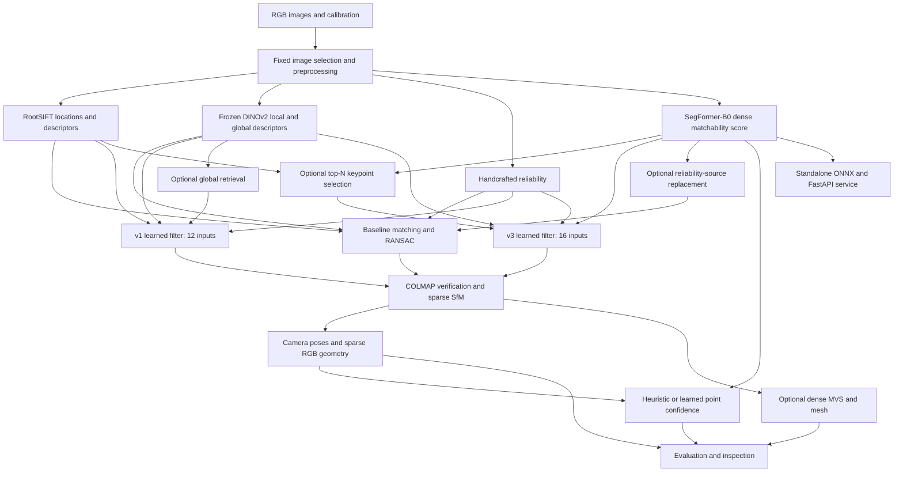

# Visibility-Aware Underwater 2D–3D Reconstruction

## Consolidated final summary: baseline, v1 and v3

**Snapshot:** 8 October 2026, Europe/Paris.  
**Package:** `underwater-vision`, version `0.1.0`, Python 3.11+.  
**Language:** English.  
**Scope:** the original reconstruction baseline, reference-supervised v1, and dense-matchability v3.  
**Primary v3 image model:** SegFormer-B0, selected by the project owner.  
**Evidence:** current source/configuration files, verified local dataset inventory, saved baseline/v1 metrics, v3 label audits and completed three-fold SegFormer/baseline evaluations, actual reconstruction artifacts, ONNX parity and Docker/API smoke records.

This document consolidates what has been implemented and measured. The requested primary-model E1/E3 benchmark is now complete: three spatial folds, three seeds, nine SegFormer runs and nine matched baseline runs. Downstream filter/confidence experiments and full-scene reconstruction remain partial. The earlier consolidated snapshot is preserved as `PROJECT_SUMMARY_FINAL_v3.md`; this updated snapshot is `PROJECT_SUMMARY_FINAL_FOLDS_v3.md`. No commit or push was performed.

## 1. Purpose, development stages and current state

The project reconstructs an underwater archaeological scene from overlapping RGB photographs and investigates whether local reliability and learned geometric evidence improve matching and reconstruction under weak texture, blur, uneven illumination, color degradation and backscatter.

| Stage | What was added | Current evidence |
| --- | --- | --- |
| Baseline/original system | Image I/O, data acquisition, RootSIFT, frozen DINO descriptors, heuristic/learned reliability, geometric verification, COLMAP SfM/MVS, confidence and visualization | Real sparse/dense clouds and meshes; controlled sixteen-image comparisons |
| v1 | Reference-geometry audit, spatial partitions, learned correspondence filtering, global image retrieval and learned point-error prediction | Reference-independent-of-project-RANSAC labels; matching/SfM/retrieval/uncertainty measurements |
| v3 | Dense image matchability supervised at RootSIFT locations, calibration, strong controls, four optional integrations, ONNX and FastAPI/Docker | Full-dataset labels; complete three-fold primary-model E1/E3; partial downstream results; trained deployment smoke checks |

The strongest established v1 result is improved match-score ranking on the development candidate pool and increased sparse support: the selected context filter reaches AP 0.9459 and reconstructs 1,890 points versus 1,790 for classical RootSIFT. Reprojection error increases, so more points do not establish improved geometric accuracy. The v1 point learner does not beat heuristic error ranking or achieve its nominal uncertainty coverage.

For v3, the completed paired three-fold comparison gives Q1 **met** and Q2 **not_met**. Detailed means and paired confidence intervals appear in section 8 and [the fold report](docs/segformer_folds_report_final_v3.md). Earlier matchability inputs reduced context-filter AP, while the point heuristic remained stronger than learned error ranking. Dense ranking, calibration and improved reconstruction are separate claims.

Full-scene end-to-end SfM/MVS across all 1,244 images and complete downstream v3 spatial-fold comparisons remain unfinished.

## 2. Input and output contract

| Input | Use |
| --- | --- |
| Overlapping underwater RGB images | Features, dense matchability, correspondences and reconstruction |
| Camera calibration | Scaled intrinsics and Brown lens-distortion parameters |
| Fixed ordered image selection | Equal inputs for comparisons; explicit filename list or start/count/stride |
| Hydra/model/training configuration | Selects independently optional pipeline components |
| Published camera-to-world poses | Reference audit, label construction, spatial partition and evaluation |
| Pretrained DINOv2 weights | Frozen local correspondence descriptors and global retrieval |
| Pretrained SegFormer encoder and trained v3 checkpoint | RGB-to-matchability prediction |
| Filter/point-error checkpoints | Optional learned correspondence filtering and confidence |
| CUDA-enabled COLMAP executable | Dense PatchMatch, fusion and meshing when requested |

Production reconstruction estimates cameras from images. Reference poses are used for training/evaluation and do not select COLMAP inliers during reconstruction. Reference poses are also used for evaluation-mode spatial guards. Production use and held-out evaluation must be distinguished.

| Output | Form and interpretation |
| --- | --- |
| Image/feature records | Preprocessed RGB, coordinates, RootSIFT/DINO descriptors and input manifests |
| Reliability | Handcrafted or learned maps and sampled keypoint evidence |
| v3 matchability | One-channel logit/score map plus bilinearly sampled per-keypoint values |
| Correspondences | Candidate indices, model scores, selected/verified matches and pair diagnostics |
| Exact-budget selections | Exactly N detected keypoints with original source-index provenance, or a clear infeasibility error |
| Camera geometry | COLMAP model and camera-to-world JSON |
| Sparse geometry | Colored PLY, tracks and confidence/error/interval fields |
| Optional dense geometry | Depth/normal maps, fused RGB cloud and Poisson mesh |
| Evaluation | AP/AUC/PR/F1, ECE/Brier, reference trajectory agreement, reprojection error, AUSE and paired intervals |
| Deployment | Trained ONNX model; HTTP image input and 16-bit score-map PNG, statistics and optional keypoints |
| Reproducibility/inspection | Resolved configs, hashes, checkpoints, MLflow records, failure records, figures, notebooks and offline 3D demo |

Outputs depend on selected stages and successful reconstruction. Dense matchability is an image prediction task with sparse keypoint supervision; it is not a semantic class mask.

## 3. Dataset, acquisition and geometry conventions

The project uses the MERMAID EPITA/LRE underwater archaeology dataset. The recorded source is [SEANOE DOI 10.17882/97987](https://doi.org/10.17882/97987); acquisition and coordinate details are in [dataset conventions](docs/dataset.md).

| Verified local item | Value |
| --- | ---: |
| Actual source RGB photographs, excluding hidden/resource-fork files | **1,244** |
| Published reference poses | **1,244** |
| Source photographs with an associated pose | **1,244** |
| Original RGB dimensions | **3,840 × 2,880** |
| Standard comparison dimensions | **960 × 720** |
| Image ZIP bytes | 3,690,513,210 |
| Extracted photograph bytes | 3,694,287,387 |
| Images checked against archive size/CRC | 1,244 |

The current loader was checked again while writing this document and agrees with `outputs/dataset_inventory.json` and `outputs/dataset_integrity.json`. Earlier informal progress notes stating 1,272 source images are superseded by this verified count. No additional dataset download is required in the prepared workspace.

Downloaded assets include images, acquisition/calibration and control-network PDFs, camera XML and the GCP-network STL. The downloader implements resume/retry, local hashes, ZIP integrity/path checks and atomic extraction. Interrupted extraction was repaired and verified. Local hashes document integrity rather than publisher-supplied checksums.

The dataset is recorded as CC BY-NC-ND 4.0; repository code is MIT. Dataset, source-model and pretrained-weight terms remain separate. The camera poses come from bundle adjustment on these images, rather than independently surveyed camera truth. The STL describes a control network rather than a dense surveyed scene surface, so dense Chamfer/F-score/accuracy/completeness are not available.

Images are resized with explicit scale factors; CLAHE is implemented but disabled in the reported main comparisons. Calibration uses Brown distortion with principal-point offsets relative to image center. OpenCV keypoints remain in their original pixel-center convention; COLMAP import adds 0.5 px. Reference epipolar calculations use Brown-undistorted coordinates. Underwater refraction is not modeled.

## 4. System architecture and baseline implementation



**Classical pipeline.** OpenCV SIFT provides keypoint locations and descriptors; RootSIFT applies L1 normalization followed by square root. Matching uses nearest neighbors, ratio 0.8 and mutual agreement, followed by fundamental-matrix RANSAC. COLMAP performs standard verification, incremental mapping and bundle adjustment. The original sixteen-view development list is acquisition IDs 0, 2, …, 30, producing 75 pairs through a six-view window.

**Frozen-descriptor variants.** DINOv2 B/14 and S/14 are supported at pinned revision `7764ea0f912e53c92e82eb78a2a1631e92725fc8`. ImageNet-normalized RGB is replicate-padded to multiples of 14; patch descriptors are bilinearly sampled at SIFT coordinates and normalized. Original fusion concatenates scaled RootSIFT/DINO descriptors, with default fusion weight 0.35. The pure-DINO descriptor ablation keeps SIFT locations and is retained as a failed reconstruction.

**Original reliability/consistency.** A 15×15 estimator combines contrast, Laplacian sharpness, gradient texture, entropy, exposure and color balance. Reliability affects correspondence scores and custom weighted eight-point RANSAC. Cross-view consistency applies Beta-smoothed repeatability from first-pass geometric evidence, with the risk of reinforcing an initial error. An original DINO-MLP reliability head was trained for twenty epochs on geometric inlier-frequency soft targets from a separate acquisition block: 1,073 training, 282 validation and 154 excluded observations; best validation BCE 0.410082. Its labels and temporal split have weak-supervision limitations.

**Reconstruction/confidence.** The database adapter imports features/matches and exports the largest registered COLMAP model. Sparse heuristic confidence combines view support, reprojection error, triangulation angle and reliability. Dense reconstruction uses COLMAP 4.2.1 CUDA for undistortion, geometric-consistency PatchMatch, fusion and Poisson meshing. Dense confidence tests depth consistency at 2% tolerance and source reliability. Nonempty meshes were obtained with depth 9, trim 0 and four threads after stronger trimming produced empty outputs. Hole closure and depth support do not establish independently measured accuracy.

## 5. Baseline development results

All successful rows below use the same sixteen images at 960×720, seed42 and fixed calibration. Internal inlier fractions and reprojection residuals are not independently measured correctness. ATE is similarity-aligned agreement in reference units.

| Method | Cameras | Sparse points | Internal inlier ratio | Reprojection px | ATE |
| --- | ---: | ---: | ---: | ---: | ---: |
| Classical RootSIFT | 16 | **1,790** | 0.9509 | 0.4259 | **0.01043** |
| RootSIFT + frozen DINO | 16 | 1,047 | 0.9531 | **0.3849** | 0.01146 |
| Handcrafted visibility | 16 | 1,065 | 0.9780 | 0.3933 | 0.01090 |
| Cross-view consistency | 16 | 1,067 | 0.9778 | 0.3942 | 0.01099 |
| Original learned reliability | 16 | 1,069 | 0.9770 | 0.3949 | 0.01210 |
| Smaller DINO S/14 visibility | 16 | 1,359 | **0.9812** | 0.3997 | 0.01085 |
| Pure DINO descriptors at SIFT locations | 0 | 0 | 0.3466 | Unavailable | Unavailable |

The classical baseline retains substantially more sparse support. Original reliability variants improve retained inlier fraction while keeping fewer matches; they do not dominate all reconstruction metrics. The pure-DINO failure is preserved, including its historically named `outputs/semantic_gpu_eval` directory; that directory is a descriptor ablation, not a class-label experiment. The earlier stale-cache run `semantic_only_eval` is excluded from conclusions.

| Existing dense run | Fused points | Depth-supported points | Mean supporting views | Mesh vertices | Mesh faces |
| --- | ---: | ---: | ---: | ---: | ---: |
| Classical | 220,038 | 220,036 | 6.2020 | 130,379 | 260,523 |
| Handcrafted visibility | 218,756 | 218,756 | 6.1416 | 133,945 | 267,663 |

These are actual saved clouds and meshes. No dense improvement attributable to v1 or v3 has been demonstrated.

## 6. v1: reference-supervised matching, retrieval and point error

### Reference audit and spatial protocol

The audit evaluated 128 pairs across the full acquisition and 11,938 tight-ratio mutual SIFT matches using reference F, without fitting a RANSAC model.

| Convention | Median epipolar error px | Fraction ≤1.5 px |
| --- | ---: | ---: |
| Brown + center-offset principal point + camera-to-world | **0.2934** | **94.14%** |
| Brown + inverse pose interpretation | 41.3848 | 3.07% |
| Camera-to-world without distortion correction | 0.9818 | 65.70% |
| Absolute principal-point interpretation | 35.1153 | 2.45% |

The selected convention passes the recorded sanity gate. Relative pose is `inverse(T_b) @ T_a`; errors are sqrt-Sampson distances after Brown undistortion. This supports convention consistency, not full physical calibration or proof of correct correspondences.

Reference camera centers projected onto the principal scene axis define 226 train, 65 validation, 743 test and 210 excluded views, with gap 0.4471966 units. Match training uses 64 selected train and 32 validation views. Fit names and out-of-slab views are rejected in evaluation mode. Camera-center gaps do not guarantee disjoint visible surfaces; the original sixteen-view test block was previously examined and is development evidence.

### Learned correspondence filtering

Each forward top-1 RootSIFT candidate receives twelve inputs: descriptor distance, ratio, mutuality, DINO cosine, two local quality scores, four normalized endpoint coordinates and two displacement coordinates. Labels are compatible at reference-F error ≤1.5 px, incompatible at ≥4 px, and ignored in between. They are independent of this project's RANSAC decisions, though derived from published BA cameras.

The independent-match MLP and custom context-attention network were trained with BCE, AdamW, clipping, twenty epochs and seed42. Context uses eight pooled latent tokens and attends back to matches; it is a custom permutation-equivariant architecture inspired by contextual filtering rather than an OANet reproduction. Training/validation/test contain 115/56/75 pairs and 19,291/11,068/82,500 known labels. Context selection, temperature and operating threshold use validation only.

| Common-pool method | AP | ROC AUC | Precision | Recall | F1 |
| --- | ---: | ---: | ---: | ---: | ---: |
| Ratio scoring/test | 0.9233 | 0.9573 | 0.9630 | 0.8213 | 0.8865 |
| RANSAC | 0.8292 | 0.9003 | 0.9927 | 0.8019 | 0.8871 |
| Original visibility score | 0.4873 | 0.6930 | 0.9944 | 0.3842 | 0.5542 |
| Official SIFT LightGlue | 0.9141 | 0.9487 | **0.9957** | **0.8978** | **0.9442** |
| MLP | **0.9473** | **0.9725** | 0.9835 | 0.8360 | 0.9037 |
| Selected context | 0.9459 | 0.9722 | 0.9914 | 0.8067 | 0.8896 |

All aligned rows share the same RootSIFT top-1 proposal pool; native matches outside it are excluded from aligned AP/AUC. LightGlue supplies the best common-pool F1 here, while the custom learners have stronger ranking AP/AUC. The context architecture was chosen by validation, despite slightly higher MLP test AP. Learned scores select matches and resolve competing assignments before standard COLMAP verification; COLMAP BA remains unweighted.

### Global retrieval

Frozen B/14 CLS descriptors were computed for all 1,244 images at a 336px longest edge. Top-12 cosine retrieval supplies 10,306 unique pairs. Its evaluator uses a reciprocal co-frustum proxy, 5×5 grid, median triangulated depth 2.8184 units and default 25% coverage, plus six depth/threshold sensitivity settings. It is an overlap proxy without scene relief or occlusion.

At nominal twelve candidates/query, sequential ±6 proxy recall is **10.08%**, DINO top12 recall **9.04%**, DINO proxy precision **87.06%**, and long-range-positive recall **4.58%**. Retrieval does not beat the sequential method on overall default-proxy recall; it adds long-range candidate edges. Hybrid pairing supplies 114 pairs on the sixteen-view block versus 75 sequential pairs, so its SfM comparison uses a larger budget.

### Point error and uncertainty

The v1 MLP predicts Gaussian `log1p(held-out reprojection error)` using eight track features: view count, maximum/minimum triangulation angle, fit error, mean/min quality and DINO agreement/variation. A deterministic observation is excluded from triangulation and all input features; it supplies the target. Tracks additionally undergo reference-XYZ spatial exclusion. The dataset contains 260 train, 127 validation and 1,678 test points; test tracks come from the classical reconstruction. Training uses 150 epochs, AdamW and Gaussian NLL, with validation-only scale fitting.

| v1 confidence method | AUSE ↓ | Spearman(error) ↑ | Error MAE px ↓ |
| --- | ---: | ---: | ---: |
| Heuristic | **0.4194** | **0.1896** | 36.6046 |
| View-count baseline | 0.4907 | 0.0675 | 30.9529 |
| Learned Gaussian log-error | 0.4910 | 0.0325 | **0.9859** |

The v1 learner does not beat heuristic ranking. Its nominal 90% interval covers **36.59%** of test errors. Simple baseline MAEs use validation-only error-unit scaling; extreme validation outliers make them unstable. Better MAE is not calibrated uncertainty. Production confidence export uses estimated SfM cameras and observed features, rather than reference targets.

### v1 SfM on identical development images

| Method | Pairs | Cameras | Points | Reprojection px | ATE |
| --- | ---: | ---: | ---: | ---: | ---: |
| Classical | 75 | 16 | 1,790 | 0.4259 | **0.01043** |
| Original visibility | 75 | 16 | 1,065 | 0.3933 | 0.01090 |
| v1 context | 75 | 16 | 1,890 | 0.4504 | 0.01078 |
| v1 MLP | 75 | 16 | 1,897 | 0.4497 | 0.01093 |
| v1 context + hybrid retrieval | 114 | 16 | **1,912** | 0.4474 | 0.01080 |

Context increases points **5.59%** over classical and **77.46%** over original visibility, while reprojection error rises. Hybrid adds 22 points with more pairs. The combined reconstruction has learned confidence/error/interval fields for all 1,912 points. These runs stop at sparse reconstruction/confidence; the older dense artifacts remain separate evidence.

## 7. v3: dense matchability prediction

### Task and selected model

v3 takes an RGB image and predicts one dense logit channel. Bilinear sampling at original RootSIFT coordinates supervises the model using reference-geometry labels, with no manual masks or classes. Its score describes where this detector and top-1 matcher meet geometric compatibility on this scene, rather than general visibility.

Three architectures were implemented: ImageNet-pretrained ResNet18-UNet, pretrained SegFormer-B0 with a one-channel head, and frozen DINOv2 B/14 with a small convolutional head. **SegFormer-B0 is now the owner-selected primary model**, recorded in `configs/matchability/selection_v3.yaml` and [the selection record](docs/model_selection_v3.md). Other architectures remain optional comparisons. DINO local/global descriptors remain independent parts of matching/retrieval.

The current primary checkpoint is `outputs/matchability_suite_v3/segformer_b0_fold0_s42_v3/model_v3.pt`, SHA256 `0d15f3458008248c24677044a7d51de914561ef6145db184959d21a7f48fce7d`. It is the existing fold0/seed42 exemplar, not a model fitted to the entire dataset or selected by the best test seed. Evaluation guards still apply to its fitted views.

### Full-dataset label construction and E0

All 1,244 source images were processed at RGB960×720 without CLAHE and saved losslessly as PNG. RootSIFT requests 4,096 features, but actual detections total **671,722**, with minimum **1**, median **218** and maximum **4,097**. Exact top-N availability must be measured rather than assumed.

Sequential-window6 and DINO-retrieved edges are combined within each slab. A pair is eligible when at least fifteen directed top-1 candidates have reference-F error ≤1.5 px; mutual candidates count in both directions. A keypoint is positive if any eligible candidate is ≤1.5 px; negative if at least two eligible candidates exist and all are ≥4 px; otherwise ignore. Ignored targets enter neither loss nor metrics. Soft targets use good/(good+bad), excluding the ambiguous band.

E0 saved per-slab counts, reference-error histograms, eligibility effects and nine threshold combinations: positive {1, 1.5, 2} px × negative {3, 4, 6} px, for sequential and hybrid graphs under four protocols. Thresholds, minimum counts, criteria and the four-epoch initial training budget were retained and frozen before final model runs.

| Protocol/slab, hybrid L1 | Images | Positive | Negative | Ignore |
| --- | ---: | ---: | ---: | ---: |
| Original v1 train | 226 | 25,737 | 10,241 | 2,508 |
| Original v1 validation | 65 | 3,495 | 1,382 | 5,594 |
| Original v1 test | 743 | 409,640 | 106,383 | 27,958 |
| Rotated fold0 train | 377 | 166,313 | 44,986 | 9,795 |
| Rotated fold0 validation | 336 | 188,931 | 66,213 | 11,990 |
| Rotated fold0 test | 376 | 57,399 | 23,372 | 5,834 |

Rotated fold1 uses 376 train / 377 validation / 336 test; fold2 uses 336 / 376 / 377. Both rotate the same physical blocks/counts shown above. Each rotated protocol excludes 155 views and uses the same 0.4471966-unit gap. The original v1 protocol excludes 210. These are three region roles within one scene, not three independent scenes.

For fold0 hybrid pairs at the frozen threshold, train retains 2,660/3,187 candidate pairs, validation 2,231/2,380 and test 1,852/3,323. Removing non-overlap candidates is essential to avoid treating lack of shared surfaces as low matchability; epipolar gating remains a proxy.

L2 labels were also completed for all protocols. Conflict-free mutual reference tracks are triangulated while holding out observations; L1 positives are certified if the median of three held-out errors is ≤2 px. Uncertified positives become ignore, while L1 negatives are retained. In the original v1 split, L2 training contains 14,833 positives, 10,241 negatives and 13,412 ignored keypoints. **L1/L2/soft model-training ablations have not yet been run.**

### Training, calibration and controls

Training uses sparse BCE with class weighting, 384×512 crops, correctly shifted keypoint coordinates, photometric-only augmentation, AdamW with encoder LR 2e-5/head LR 3e-4, CUDA AMP FP16, cosine schedule, gradient clipping and batch1/accumulation4. Keypoints are not recomputed after augmentation. The intended seeds are 42/43/44 and the fixed budget is four epochs. Checkpoints are selected on spatial-validation AP; scalar temperature is fitted on validation only. Runs are recorded with MLflow. Four epochs are an initial budget, not evidence of convergence.

Controls include random, SIFT response, scale+response, handcrafted reliability, freshly trained frozen-DINO MLP, logistic regression and gradient boosting on the same six per-keypoint statistics. Train/validation tabular fitting uses at most 512 labeled keypoints per image; test evaluates all known labels. Dense inference uses full images and bilinear coordinate sampling. No test labels fit normalization, model weights, calibration or operating thresholds.

### Four detachable integrations

| Integration | Implementation | Validation state |
| --- | --- | --- |
| I1: match-filter inputs | Append m_a, m_b, min(m_a,m_b), mean(m_a,m_b), giving 16 inputs; retrain context and MLP | Two fold0 seeds measured; current AP lower than 12-input controls |
| I2: keypoint selection | Exact N ∈ {512,1024,2048,4096}, with source indices, response/random controls and rematching | Initial curves saved; many budgets infeasible and corrected reruns pending |
| I3: reliability source | Independent `visibility.source` switch for handcrafted, DINO-head or matchability scores | Implemented; complete source-swap SfM benchmark pending |
| I4: point-error inputs | Add mean/min track matchability to eight inputs; robust learner and conformal intervals | Two fold0 seeds measured; no win over heuristic established |

The map provider can be used standalone. Match-feature versions and the consuming model's matchability SHA are checked; old twelve-input checkpoints are rejected for sixteen-input mode. Source replacement, budgeting and point confidence remain independent choices. Selecting SegFormer does not automatically validate every downstream integration.

## 8. Complete primary-model folds and partial downstream measurements

The original 57-command suite stopped during command 14; its record remains historical. At the owner's later request, a separate frozen E1/E3 benchmark completed all three spatial folds and seeds 42/43/44 with SegFormer-B0 and seven matched controls. Four verified finished runs were reused; fourteen new commands completed. The interrupted seed44 was rerun in a new folder. All 18 configurations and prediction populations were checked. Other dense backbones and E4-E7 were not completed by this narrower benchmark.

### E1/E3: complete keypoint matchability and calibration

| Fold | SegFormer mean AP | Strongest control | Control mean AP | AP difference | Paired 95% CI |
| --- | --- | --- | --- | --- | --- |
| fold0 | 0.885073 | dino_mlp | 0.879971 | 0.005102 | [-0.004757, 0.013552] |
| fold1 | 0.840394 | dino_mlp | 0.822597 | 0.017796 | [0.011027, 0.025558] |
| fold2 | 0.886966 | dino_mlp | 0.876570 | 0.010396 | [0.006791, 0.014572] |

| Fold | Seed | Test AP | ROC AUC | ECE after | Brier after |
| --- | --- | --- | --- | --- | --- |
| fold0 | 42 | 0.884234 | 0.783489 | 0.047924 | 0.162468 |
| fold0 | 43 | 0.882831 | 0.776936 | 0.057485 | 0.166926 |
| fold0 | 44 | 0.888155 | 0.792396 | 0.052903 | 0.158941 |
| fold1 | 42 | 0.830307 | 0.650268 | 0.125579 | 0.204475 |
| fold1 | 43 | 0.847265 | 0.675048 | 0.148163 | 0.205047 |
| fold1 | 44 | 0.843610 | 0.669163 | 0.063849 | 0.184413 |
| fold2 | 42 | 0.885566 | 0.694141 | 0.179275 | 0.191319 |
| fold2 | 43 | 0.888104 | 0.699608 | 0.150594 | 0.179230 |
| fold2 | 44 | 0.887227 | 0.697758 | 0.153240 | 0.180722 |

Q1 is **met**; positive-CI regions are ['fold1', 'fold2']. Q2 is **not_met**. Temperature and checkpoint selection use spatial validation only. Outputs remain matchability scores when calibration fails. AP is average precision, not accuracy.

Paired intervals use 500 exact weighted-AP image-cluster resamples, common across seeds before averaging. Strongest-control selection uses mean test AP; intervals condition on that choice. There are three regions in one scene. Adjacent images/shared surfaces can remain correlated; these intervals do not measure new-scene uncertainty.

All seven control means, per-seed calibration, retention plots and binned analyses are in [the new report](docs/segformer_folds_report_final_v3.md) and [comparison JSON](outputs/segformer_folds_v3/comparison_v3/comparison_v3.json). Earlier ResNet18-UNet and DINO-head runs remain separately preserved.

### E4: correspondence filters on identical v3 pools

| Filter | AP seed42 | AP seed43 |
| --- | ---: | ---: |
| Retrained context, 12 inputs | **0.634701** | **0.636315** |
| Context + matchability, 16 inputs | 0.621524 | 0.617832 |
| Retrained MLP, 12 inputs | **0.626031** | **0.624091** |
| MLP + matchability, 16 inputs | 0.614949 | 0.618132 |

Paired 95% pair-bootstrap CIs for context AP(16)−AP(12) are **[-0.026289, -0.000577]** at seed42 and **[-0.031385, -0.006049]** at seed43. The added features reduce AP on this region/pool. Precision/recall/F1 and thresholds selected from validation are also saved.

Train/validation use 64/32 selected views with nearest-center and distant pairs. Rotated test pools use 32 views sampled across the full slab, then a six-view window over that selected list, including difficult/non-overlapping pairs. This differs from the compact historical sixteen-view sequence. Historical v1 AP 0.9459 cannot be directly subtracted from these v3 APs; the fair causal comparison is 12 versus 16 inputs on identical current candidates. Pairwise CIs are conditional on this selected pool and do not make all pairs geometrically independent.

### E5: exact-budget comparison

Initial recall/compatible-count/precision/matching-time curves were saved for the two completed filter runs. Both endpoints must contain at least N detected points; infeasible pairs are recorded rather than clipped. With median 218 detections, much of the requested budget range is unavailable. Feasible pair subsets differ across N, preventing a fully observed end-to-end frontier.

The original random control reused a seed at both endpoints. Independent per-image SHA256(seed:image-name) seeds and five matching warm-up calls have been implemented, but corrected curve reruns are pending. The initial curves therefore are not final evidence for Q4. Matching time excludes feature extraction/map inference; no overall latency improvement is claimed.

### E7: point-error ranking and confidence

Tracks use reference-compatible observations from all non-excluded views of the slab. One/two observations are held out in each of three deterministic repeat groups; held-out coordinates, DINO, quality and matchability are excluded from inputs. Fold0 contains 20,803 train, 23,505 validation and 6,602 test tracks, producing 61,886/69,880/19,660 held-out rows. Track-median errors/predictions are evaluated. Robust eight-input controls separate the added-feature effect from loss changes. Conformal intervals use a separate validation-track subset in log-error space.

| Model/control | AUSE seed42 ↓ | AUSE seed43 ↓ |
| --- | ---: | ---: |
| Retrained v1 Gaussian, 8 inputs | 0.392055 | 0.365613 |
| Robust learner, 8 inputs | 0.347896 | 0.354809 |
| Matchability learner, 10 inputs | 0.325582 | 0.327160 |
| Heuristic | **0.291487** | **0.291487** |
| View-count ranking | 1.178331 | 1.178331 |

At seed42, AUSE(10)−AUSE(v1 learned) has CI **[-0.126870, -0.017599]**; versus robust8 **[-0.047927, -0.005772]**; versus heuristic **[-0.035235, 0.099425]**. At seed43, both learned-control intervals cross zero. This is promising for the learned controls but does not establish Q5. AUSE uses the original mean-normalized 100-step definition with tie averaging and can exceed one. Heuristic/view-count scores have no direct pixel-error units, so their raw score MAEs are not interpreted as error-prediction MAEs.

Spearman, learned-model MAE, coverage, sparsification/calibration curves and paired track-bootstrap draws are saved. E1/E4/E7 binned-statistic tools cover contrast, scale, sharpness, brightness and frame position; point bins are saved, while final consolidated analysis/figures are pending. Old v1 and current point populations differ substantially, so their AUSE difference is not a causal before/after improvement.

### Compatibility and E6 state

The original v1 context reconstruction was rerun with matchability off: **16 cameras, 1,890 points, mean reprojection error 0.4504205128199967 px**, versus preserved **0.4504205128199975 px**, agreeing within 1e-12. This verifies numerical backward compatibility, not bitwise artifact identity.

The planned new classical/retrained-v1/+matchability/+topN SfM comparison on the same sixteen images has **not** been run. No v3 point-count, ATE or full-scene reconstruction improvement is claimed. The exact top512 method may be infeasible on some original inputs; it must remain a recorded failure rather than silently altering inputs.

## 9. v3 deployment, cache corrections and verification

A trained SegFormer checkpoint was exported to ONNX, with fixed spatial input **720×960**, dynamic batch, RGB float NCHW [0,1] and embedded normalization. CPU FP32 maximum absolute logit difference was **1.9818544e-6**, with tolerance atol=1e-4/rtol=1e-3; doubled-batch output passed. Temperature is stored with deployment metadata. ONNX SHA256 is `fcef3d0fc2be69d54fff4cb78c81c9208d774dc549160d42205f4ba1d7292fc7`.

`Dockerfile.matchability` was actually built and its CPU ONNX FastAPI container launched. A real image returned a **720×960 16-bit PNG** score map and **32 selected keypoints**, with original indices; `/health` and invalid-image HTTP400 passed. Image/container IDs, mounts and HTTP results are saved. Docker was subsequently stopped to release resources. Its single approximately 2.26-second smoke request includes HTTP/decoding/model/keypoint work and is **not** a formal latency benchmark. Warmed-up FP32/FP16 model-only GPU latency, throughput and peak allocated VRAM remain pending.

The initial DINO evaluation-grid cache reduced head-input precision and failed strict parity with max logit difference **0.0019002**. Its audit/run are preserved. The replacement stores FP32 values and restores original strides, with a 5GB bound; on the audited real image, grid and logit differences were **zero**. Augmented crops bypass this cache. The early DINO fold0 seed43 result still needs a rerun under a new name. Sampled frozen-DINO descriptors separately use a consistent FP16 storage/FP32 normalized-read policy for the baseline/filter experiments.

Matchability cache keys include image state, resolution, checkpoint hash, temperature, backend/device/precision. Run names refuse overwrite; provenance includes configs, seeds, spatial manifests, label versions, audit/model hashes and preserved failures.

Historical checks include **26 tests** at baseline publication, **35 tests** at the v1 snapshot, an intermediate full-tree **84-test pass**, and a later **28-test matchability-only pass**. The matchability test file now contains **29 test functions**, including a subsequently added lossless-cache check. Final pytest/Ruff/Black verification of the latest complete tree has **not** been rerun; historical passes are not presented as current-tree certification. No new software test run was started to produce this summary. Actual ONNX, Docker and backward-compatible SfM checks are separately evidenced above.

## 10. Frozen research questions and measured status

| Criterion | Required evidence | Current assessment |
| --- | --- | --- |
| Q1: dense model beats strongest control | Paired positive AP CI in ≥2/3 spatial folds, including tabular controls | **met**; positive regions: ['fold1', 'fold2'] |
| Q2: calibrated output | ECE ≤0.05 on held-out regions | **not_met**; all nine seeds measured; per-seed failures in comparison JSON |
| Q3: improved context filtering | Positive AP CI against retrained 12-input context in ≥2/3 folds | **Not established:** both completed fold0 seeds have negative CIs |
| Q4: better equal-budget selection | Improved compatible-candidate recall versus response/random at exact N | **Inconclusive:** missing budgets and corrected random-control reruns pending |
| Q5: improved point-error ranking | Lower AUSE than retrained v1 learner and heuristic, paired CI below zero | **Not established:** heuristic still better; intervals insufficient |

Model selection is an engineering decision to proceed with SegFormer, not a claim that every scientific criterion has passed. The frozen v3 criteria remain unchanged. Altering budgets, pairing or tuning after viewing these results requires a separately identified exploratory protocol.

## 11. Repository and artifact map

| Code area | Responsibility |
| --- | --- |
| `data/`, `preprocessing/` | Download/load, pose parser, selections, spatial splits and image preprocessing |
| `features/`, `retrieval/` | RootSIFT/DINO descriptors, feature cache and global image pairs |
| `geometry/`, `matching/` | Reference labels, RANSAC, twelve/sixteen-input MLP/context and LightGlue adapter |
| `visibility/source.py` | Independent reliability-source switch |
| `matchability/labels.py`, `build.py`, `strong_labels.py` | L1/soft/L2, graph eligibility and E0 |
| `matchability/dataset.py`, `model.py`, `loss.py`, `train.py` | Dense models and sparse-supervision training |
| `matchability/infer.py`, `calibration.py`, `frozen_cache.py` | Standalone score maps, sampling, calibration and lossless frozen cache |
| `matchability/tabular_baseline.py`, `experiments.py` | Statistical controls, filter retraining and budgeting |
| `matchability/confidence.py`, `pointcloud/` | Heuristic/learned track error and confidence exports |
| `reconstruction/colmap/`, `pipeline.py`, `research_pipeline.py` | Database, SfM/MVS and optional orchestration |
| `evaluation/`, `matchability/report.py`, `documentation.py` | Metrics, paired bootstraps, bins and report generation |
| `serving/matchability_api.py`, `matchability_export.py` | Trained ONNX parity/timing and FastAPI |
| `configs/`, `scripts/`, `tests/`, `visualization/`, `notebooks/` | Configuration, commands, checks, plots and offline inspection |

| Saved evidence | Location |
| --- | --- |
| Dataset/integrity | `data/raw/mermaid/`, `outputs/dataset_inventory.json`, `outputs/dataset_integrity.json` |
| Baseline sparse/dense/mesh | `outputs/classical_eval/`, `outputs/visibility_gpu_eval/` |
| Baseline comparison/learned reliability | `outputs/comparison/comparison.json`, `outputs/models/reliability.pt` |
| v1 audit/models/evaluation | `outputs/reference_audit_v1/`, `outputs/match_filter_v1/`, `outputs/match_evaluation_v1/` |
| v1 retrieval/point confidence | `outputs/retrieval_v1/`, `outputs/point_confidence_v1/` |
| v1 SfM comparisons | `outputs/match_filter_sfm_v1/`, `outputs/mlp_filter_sfm_v1/`, `outputs/retrieval_filter_sfm_v1/` |
| v1 consolidated results/figures | `outputs/comparison_v1/comparison_v1.json`, `docs/figures_v1/` |
| v3 labels and stronger labels | `outputs/matchability_labels_v3/`, `outputs/matchability_l2_labels_v3/` |
| v3 seeded results and stop record | `outputs/matchability_suite_v3/`, `pause_status_v3.json` within that root |
| v3 compatibility | `outputs/v1_compatibility_v3/` |
| v3 trained ONNX and Docker smoke | `outputs/matchability_deployment_preview_v3/`, `outputs/matchability_docker_smoke_v3/` |
| v3 cache failed/passed audits | `outputs/matchability_frozen_cache_audit_v3/`, `outputs/matchability_frozen_cache_lossless_retry_v3/` |
| Owner selection and historical stopped progress | `docs/model_selection_v3.md`, `PROJECT_PROGRESS_V3.md` |
| Summary evidence snapshot | `outputs/final_summary_snapshot_v3/summary_evidence_v3.json` |
| Offline demo and notebooks | `outputs/demo.html`, five `notebooks/01_...` through `05_...`, executed copies under `outputs/publication/` |

The primary-model central comparison is now `outputs/segformer_folds_v3/comparison_v3/comparison_v3.json`, with the new English fold report and four figures in `docs/figures_v3/segformer_folds_v3`. The broader all-experiment `outputs/comparison_v3/comparison_v3.json` and complete research/model/dataset cards remain pending; the primary-model comparison does not substitute for missing downstream measurements.

## 12. Reproduction, deployment and detachment

The stack includes NumPy/SciPy, OpenCV, PyTorch/torchvision, transformers, scikit-learn, PyCOLMAP, external CUDA COLMAP, Hydra/OmegaConf, MLflow, Matplotlib/Plotly/Open3D and pytest/Ruff/Black. Recorded neural hardware is an RTX4060 Laptop GPU with 8GB VRAM. Local experiment results, data, weights, binaries, caches and environments are excluded from Git. A fresh clone requires installation/data acquisition.

Examples below are for deliberate future execution; they were not executed while updating this summary. Use fresh output names.

```powershell
# Install optional research/matchability/serving dependencies.
.venv\Scripts\python.exe -m pip install -e ".[neural,research,matchability,serving,dev,visualization]"

# v1 context on the original sixteen-view development list.
.venv\Scripts\python.exe scripts/run_experiment.py experiment=learned_matches data.image_list=configs/evaluation_images.txt run_name=summary_context_review_v1

# Train the selected image model alone; explicitly choose a fresh run name.
.venv\Scripts\python.exe scripts/train_matchability.py --dataset outputs/matchability_labels_v3 --protocol fold0 --model configs/matchability/model/segformer_b0.yaml --seed 42 --output outputs/segformer_review_v3

# Serve the existing trained ONNX checkpoint independently of reconstruction.
.venv\Scripts\python.exe scripts/serve_api.py --task matchability --onnx outputs/matchability_deployment_preview_v3/matchability_v3.onnx --metadata outputs/matchability_deployment_preview_v3/deployment_v3.json --port 8003

# Inspect the full research suite without starting training.
.venv\Scripts\python.exe scripts/run_matchability_ablation.py --output outputs/review_plan_v3 --dataset outputs/matchability_labels_v3 --plan-only

# Original dense confidence viewer.
.venv\Scripts\python.exe scripts/view_pointcloud.py outputs/visibility_gpu_eval/dense/fused_confidence.ply --confidence
```

The full ablation-suite implementation still schedules all three architectures and all folds/seeds; it is distinct from the owner's choice of SegFormer as the main model. It does not automatically resume the interrupted suite and existing names cannot be overwritten.

The default original experiment is classical. `learned_matches` enables v1; `matchability_matches` enables optional v3 filter inputs. Pairing, reliability replacement, exact budgets and learned point confidence are independently configured. A deployment checkpoint must match the consumer's hash and spatial protocol. The fold0 example config must not be used as an unguarded replacement on arbitrary historical evaluation images.

To restore v1 behavior, choose its original filter/experiment, omit optional map/source/point checkpoints, set `matching.matchability_features="off"` where present and leave budgeting unset. To use SegFormer alone, instantiate `MatchabilityPredictor` or serve the ONNX API. These changes do not require editing the COLMAP core.

## 13. Completed engineering work, publication and remaining tasks

The original project was published as fifteen owner-reviewed commits without numeric prefixes, ending at `06288de` (`documenting`); contents/checks are recorded in [the commit review record](docs/commit_plan.md). Later research work remains in the working tree. This update did not commit or push it.

Completed engineering checks include real feature extraction, COLMAP sparse/dense exports, nonempty meshes, original package construction, five executed notebooks, offline demo rendering, reference-label geometry tests, spatial/held-out isolation checks, filter feature/hash guards, API image validation and actual trained deployment parity/smoke checks. Failed pure-DINO, mesh/cache experiments and interrupted runs remain traceable.

| Remaining item | State |
| --- | --- |
| Current-tree software checks | 97 tests passed; Ruff passes for src/scripts/tests; Black passes for 147 Python files. Existing notebook lint findings remain outside that scope |
| Corrected DINO seed43 and independent-random E5 reruns | Pending |
| SegFormer primary-model E1/E3 spatial folds | Completed: 3 folds × 3 seeds and all seven matched controls |
| L1/L2/soft training comparisons | Labels ready; training pending |
| v3 identical-input end-to-end SfM comparison | Script implemented; measurements pending |
| Complete three-fold point-confidence/uncertainty evidence | Two fold0 seeds only |
| Formal warmed-up GPU FP32/FP16 timing | Pending; smoke request is not a substitute |
| Primary-model comparison/report/figures | Completed; broader all-experiment comparison/cards remain pending |
| Full-scene connectivity/SfM/MVS | Pending |
| Independent surveyed geometry/new-scene validation | Not available |

The next research work should investigate the negative filter effect, region calibration shift and exact-budget feasibility before more large runs. Complete the frozen comparisons without redefining success from observed test outcomes. A useful dense predictor, a deployable API and an improved reconstruction are separate claims requiring separate evidence.

## 14. Interpretation limits and supporting documents

Reference BA cameras and epipolar compatibility are proxies, not independent surveyed truth. RootSIFT/top1 selection biases the dense target. Sparse keypoint supervision does not validate every map pixel, every scale/orientation, another detector or another scene. Eligibility can admit accidental geometric alignments. Camera-center gaps do not guarantee separate visible surfaces. Three seeds are not three independent scenes. Refraction, physical visibility and independent dense accuracy remain unmodeled/unmeasured. More points, higher retained inlier ratio, lower residual or a successful software test cannot establish overall geometric superiority.

SegFormer pretrained revision is `80983a413c30d36a39c20203974ae7807835e2b4`. [The model card](https://huggingface.co/nvidia/mit-b0) points to [NVIDIA's SegFormer license](https://github.com/NVlabs/SegFormer/blob/master/LICENSE), with noncommercial research/evaluation restrictions. [DINOv2](https://github.com/facebookresearch/dinov2/blob/main/LICENSE) is Apache-2.0; [torchvision](https://github.com/pytorch/vision/blob/main/LICENSE) code is BSD-3-Clause with separate pretraining-data terms. Repository MIT licensing does not supersede image/checkpoint terms.

- [Original detailed summary](PROJECT_SUMMARY.md), [baseline status](PROJECT_STATUS.md), [baseline comparison](outputs/comparison/comparison.json).
- [v1 summary](PROJECT_SUMMARY_v1.md), [v1 research report](docs/research_report_v1.md), [v1 comparison](outputs/comparison_v1/comparison_v1.json).
- [v3 stopped progress](PROJECT_PROGRESS_V3.md), [SegFormer selection](docs/model_selection_v3.md), [v3 label audit](outputs/matchability_labels_v3/audit_v3.json), [stop record](outputs/matchability_suite_v3/pause_status_v3.json).
- [Dataset conventions](docs/dataset.md), [methodology](docs/methodology.md), [experiment protocol](docs/experiments.md), [limitations](docs/limitations.md).
- Methodological references: [OANet](https://arxiv.org/abs/1908.04964), [LightGlue](https://github.com/cvg/LightGlue), [SegFormer](https://github.com/NVlabs/SegFormer), [DINOv2](https://github.com/facebookresearch/dinov2), [temperature scaling](https://arxiv.org/abs/1706.04599), [sparsification/uncertainty evaluation](https://arxiv.org/abs/1802.07095).
