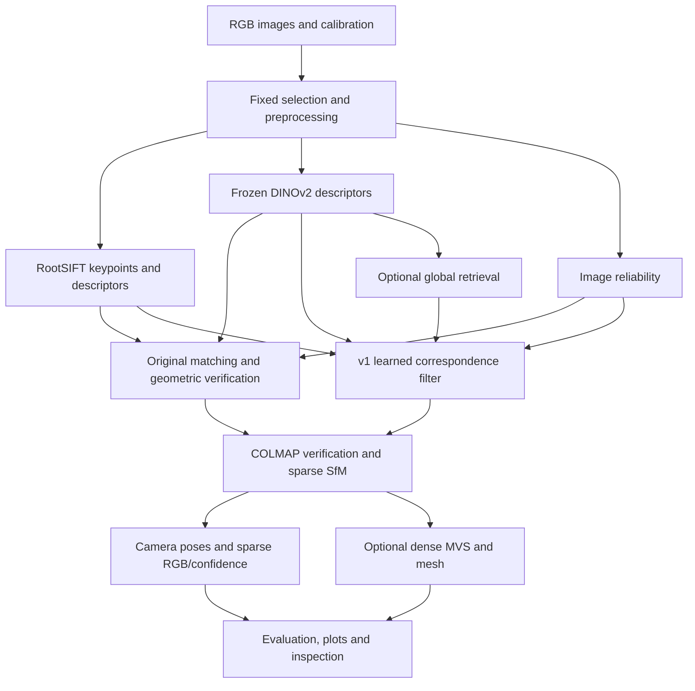

# Visibility-Aware Underwater 2D–3D Reconstruction

## Consolidated project summary: original system, baselines and v1

**Snapshot:** 8 October 2026, Europe/Paris.  
**Package:** `underwater-vision`, version `0.1.0`.  
**Language:** English.  
**Scope:** the original reconstruction project and its reference-supervised v1 extension.  
**Evidence:** source/configuration files, verified local dataset inventory, saved baseline metrics, v1 training/evaluation records and existing reconstruction artifacts.

This is a consolidated account of completed implementation and measured development results. “Final summary” refers to this document, not completion of a full-scene research benchmark. Existing reports and result directories are preserved.

## 1. Purpose and current state

The project reconstructs an underwater archaeological scene from overlapping RGB photographs. It investigates whether local image reliability, frozen neural descriptors and learned geometric evidence improve correspondence selection and reconstruction support under blur, low texture, uneven illumination and underwater color degradation.

The implemented system includes a complete classical baseline, several controlled descriptor/reliability ablations, COLMAP sparse reconstruction, optional dense MVS and meshing, sparse/dense confidence exports, reference-camera evaluation and a reference-supervised learned extension.

The v1 extension introduces three independently evaluated components: learned correspondence filtering, global image retrieval and learned point-error prediction. Its reference-geometry audit provides labels independent of this project's RANSAC decisions.

The principal measured outcomes are:

- Learned match ranking reaches **AP 0.9459** for the selected context model, versus **0.9233** for ratio scoring on the same proposal pool.
- Context-filtered SfM reconstructs **1,890 sparse points**, versus **1,790** for classical RootSIFT and **1,065** for the original visibility variant, with all **16 cameras** registered.
- Hybrid retrieval plus context filtering produces **1,912 points**, although it uses more image pairs and is not an equal-cost comparison.
- Reprojection error increases relative to the classical baseline. More reconstructed points therefore do not establish better geometric accuracy.
- Learned point-confidence ranking and uncertainty calibration remain unsuccessful: **AUSE 0.4910**, versus **0.4194** for the heuristic, and **36.59%** coverage for nominal 90% intervals.

This is a working, measured research prototype. The end-to-end comparisons use one sixteen-image development block, not a completed reconstruction of all 1,244 images.

## 2. Inputs and outputs

| Input | Role |
| --- | --- |
| Overlapping underwater RGB photographs | Observations for feature extraction, matching and reconstruction |
| Camera calibration | Scaled intrinsics and Brown lens-distortion parameters |
| Fixed ordered image list | Identical inputs for controlled comparisons; also supports start/count/stride selection |
| Hydra configuration | Selects features, pairing, reliability, matching, reconstruction and output settings |
| Published camera-to-world reference poses | Reference audit, supervision, spatial partitioning and trajectory evaluation |
| Pretrained DINOv2 weights | Frozen local descriptors and global retrieval descriptors |
| Learned model checkpoints | Optional reliability, match filtering and point-error prediction |
| CUDA-enabled COLMAP executable | Required for dense PatchMatch, fusion and meshing |

Reference poses are not required to estimate a production reconstruction. They are required for the reference-supervised training/evaluation described here. They do not select accepted COLMAP matches during inference.

| Output | Saved representation |
| --- | --- |
| Preprocessed images and selected inputs | Images, input manifests and resolved YAML |
| Keypoints and descriptors | Coordinates, RootSIFT and optional DINOv2 arrays in NPZ caches |
| Image/feature reliability | Maps, sampled scores, diagnostics and figures |
| Correspondences | Candidate indices, scores/probabilities, verified matches and pair metrics |
| Camera geometry | COLMAP sparse model and camera-to-world JSON |
| Sparse 3D geometry | Colored PLY, track statistics and confidence NPZ/PLY |
| Optional dense geometry | Depth/normal maps, fused colored point cloud and Poisson mesh |
| Learned point evidence | Predicted error, confidence and interval fields |
| Evaluation | Reference audit, AP/AUC/PR/F1, trajectory/reprojection metrics, retrieval metrics and sparsification/calibration plots |
| Reproducibility and inspection | Configs, hashes, status/failure records, figures, notebooks and an offline interactive HTML demo |

Outputs depend on the selected stage and successful reconstruction. Feature/matching runs can stop before SfM; dense processing is optional.

## 3. Dataset acquisition and verified inventory

The project uses the MERMAID underwater archaeology dataset from EPITA/LRE, distributed through [SEANOE](https://www.seanoe.org/data/00868/97987/) with [DOI 10.17882/97987](https://doi.org/10.17882/97987).

| Verified local item | Value |
| --- | ---: |
| Actual source RGB photographs | **1,244** |
| Published reference poses | **1,244** |
| Photographs associated with reference poses | **1,244** |
| Original RGB resolution | **3,840 × 2,880** |
| Standard development resolution | **960 × 720** |
| Original image ZIP bytes | **3,690,513,210** |
| Extracted photograph bytes | **3,694,287,387** |
| Images verified against archive size/CRC | **1,244** |

The count above is supported by `outputs/dataset_inventory.json`, `outputs/dataset_integrity.json`, the current dataset loader and the source-photograph directory. Hidden files and macOS resource forks are not counted as photographs. Public overview counts differ; the report uses the verified local inventory.

Downloaded assets include the image ZIP, acquisition/calibration PDF, reference-network PDF, camera XML and a GCP-network STL. The downloader supports range resume, source metadata, local hashes, extraction-path checks and atomic image writes. An interrupted extraction was repaired from the complete archive, and size/CRC checks passed afterward.

The reference poses were estimated through bundle adjustment on the images. They are useful photogrammetric references, not independently surveyed camera truth. The STL represents a control network, not a surveyed dense scene surface. It cannot justify dense surface accuracy or completeness claims.

Repository code is MIT licensed. The dataset is recorded as CC BY-NC-ND 4.0; dataset and pretrained-weight terms are separate from the code license. See [dataset conventions](docs/dataset.md).

## 4. Architecture and implemented baseline methods



### Image preprocessing and coordinates

Images are resized with preserved aspect ratio and explicit scale factors. CLAHE is implemented but disabled for the selected comparisons. Calibration is interpreted as Brown distortion with principal-point offsets relative to the image center and imported as COLMAP `FULL_OPENCV` with zero denominator distortion terms.

SIFT coordinates use OpenCV pixel centers. Import into COLMAP adds 0.5 px. Custom/reference epipolar calculations use undistorted observations; COLMAP receives original distorted image coordinates with the configured calibration.

### Classical baseline

OpenCV SIFT supplies localized keypoints and 128-dimensional descriptors. RootSIFT applies L1 normalization followed by elementwise square root. The configuration requests 4,096 features; actual detections can be fewer. Matching uses nearest neighbors, a ratio threshold of 0.8 and mutual agreement. The fixed sixteen-image sequence supplies 75 pairs through a six-view window.

Custom geometric verification uses a fundamental matrix and RANSAC. COLMAP subsequently verifies retained correspondences, performs incremental mapping and optimizes its standard bundle-adjustment objective.

### Frozen-DINO descriptor variants

Official DINOv2 B/14 and S/14 are supported, pinned to revision `7764ea0f912e53c92e82eb78a2a1631e92725fc8`. Images receive ImageNet normalization and replicated padding to multiples of 14. Patch descriptors are bilinearly sampled at SIFT coordinates and L2-normalized. The encoder is frozen.

The original neural variant concatenates scaled RootSIFT and DINO descriptors using a default fusion weight of 0.35. A pure-DINO descriptor ablation retains the same SIFT locations. Here, DINO's contextual features do not imply semantic class labels or object recognition.

### Handcrafted visibility, weighted RANSAC and consistency

The original visibility estimator uses a 15×15 neighborhood and combines contrast, Laplacian sharpness, gradient texture, entropy, exposure and color balance. Reliability weights correspondence scores and the sampling/scoring of custom eight-point RANSAC hypotheses. These are heuristic evidence scores, not calibrated physical visibility probabilities.

The cross-view variant estimates Beta-smoothed repeatability from first-pass geometric successes, then updates scores and repeats verification. This can reinforce errors in the initial geometry.

### Original learned reliability head

A small MLP maps frozen DINO descriptors to feature reliability. It was trained for 20 epochs on geometric inlier-frequency soft labels from a separate 32-view acquisition block. There were 1,073 training observations, 282 validation observations and 154 excluded boundary observations. Best validation BCE was 0.410082; the checkpoint is `outputs/models/reliability.pt`.

This original head learns from matcher/verifier outcomes and has weak-label selection bias. Its temporal acquisition separation does not prove spatial separation. It is distinct from the independently reference-labeled v1 match filter described below.

### Sparse/dense reconstruction and confidence

The COLMAP adapter builds the database, imports keypoints/matches, verifies geometry, maps cameras and exports the largest registered model. Sparse confidence combines observing-view count, reprojection error, maximum triangulation angle and mean source reliability.

Dense reconstruction uses the local COLMAP 4.2.1 CUDA executable for undistortion, geometric-consistency PatchMatch, stereo fusion and optional Poisson meshing. Existing nonempty meshes use depth 9, trim 0 and four threads after stronger trimming produced empty outputs.

Dense confidence checks projected fused points against geometric depth maps, using 2% relative-depth tolerance and source-image reliability. Unsupported points receive zero confidence. Sparse and dense confidence are observational heuristics; neither establishes independent surface accuracy. Untrimmed Poisson meshing can close unsupported holes.

## 5. V1 reference-supervised extension

### Reference-geometry audit

Before supervised matching, the audit checked 128 image pairs distributed over the full acquisition, containing 11,938 mutual tight-ratio SIFT matches. It evaluated reference-F errors without estimating a RANSAC model.

For camera-to-world transforms, relative geometry is `inverse(T_b) @ T_a`; the essential/fundamental matrices follow from this relative pose and calibrated intrinsics. Observations are Brown-undistorted before sqrt-Sampson error is evaluated.

| Convention tested | Median epipolar error, px | Fraction ≤1.5 px |
| --- | ---: | ---: |
| Brown, center-offset principal point, camera-to-world | **0.2934** | **94.14%** |
| Brown, inverse pose convention | 41.3848 | 3.07% |
| Camera-to-world without distortion correction | 0.9818 | 65.70% |
| Absolute principal-point interpretation | 35.1153 | 2.45% |

The selected interpretation passes the recorded sanity gate. This supports consistency with the published camera conventions; it is not a complete physical validation of underwater calibration. Epipolar compatibility is necessary but does not prove that a match is correct.

### Spatial training/evaluation separation

Reference-camera centers are projected onto the principal scene axis. The original development region anchors the test interval, with exclusion bands separating roles.

| Role | Available views |
| --- | ---: |
| Train | 226 |
| Validation | 65 |
| Test slab | 743 |
| Excluded | 210 |

The exclusion gap is 0.4471966 reference units. Match training uses 64 selected train views and 32 validation views. Normalization fits train data; checkpoint selection, temperature and decision threshold use validation. Evaluation guards reject fit images and out-of-slab cameras.

The actual end-to-end comparison uses the original sixteen-image development list, acquisition IDs 0, 2, …, 30. These views were already examined during baseline development; they are not a new blind test. Camera-center separation also does not guarantee disjoint visible surfaces.

### A. Learned correspondence filtering

Every forward top-1 RootSIFT proposal receives twelve inputs: descriptor distance, nearest-neighbor ratio, mutuality, DINO cosine similarity, image quality at both endpoints, four normalized endpoint coordinates and two displacement coordinates. Proposals are generated before ratio filtering so negatives remain available.

Reference-F error ≤1.5 px labels a compatible proposal; error ≥4 px labels an incompatible proposal. The ambiguous band is ignored. This supervision is independent of the project's RANSAC mask, although the reference cameras themselves originate from dataset bundle adjustment.

Two models were implemented and trained: an independent-match MLP and a custom context-attention network. The context model pools pair information into eight latent tokens and attends back to matches, preserving permutation equivariance without a full quadratic match-attention matrix. It is inspired by contextual correspondence filtering, not a reproduction of OANet.

Training uses BCE, AdamW, gradient clipping, 20 epochs and seed 42. The context model was selected by spatial-validation AP; MLP remains an ablation. Training/validation/test comprise 115/56/75 pairs and 19,291/11,068/82,500 known labels.

At inference, learned scores filter proposals and resolve competing feature assignments. This v1 path replaces fixed descriptor-fusion selection and custom weighted RANSAC with learned filtering followed by standard COLMAP verification. It does not weight COLMAP's bundle-adjustment objective.

### B. Global image retrieval

Frozen DINOv2 B/14 CLS descriptors were extracted for all 1,244 images at a longest edge of 336 px. Cosine top-12 retrieval produces 10,306 unique pairs. Inference uses images alone; reference poses enter evaluation afterward.

The overlap evaluator uses a reciprocal co-frustum proxy with a 5×5 sample grid, a reference-triangulated median depth of 2.8184 units and a default 25% overlap threshold. Six sensitivity settings vary depth and threshold. This proxy ignores scene relief and occlusion and is not measured overlap ground truth.

At equal nominal budget of twelve neighbors/query, sequential ±6 recall is 10.08% and DINO recall is 9.04%. DINO has 87.06% proxy precision and 4.58% long-range-positive recall for pairs beyond six indices. It adds a class of distant candidates absent from the sequential window, but does not beat sequential recall overall under the default proxy.

Hybrid retrieval combines both graphs. On the sixteen development images it provides 114 pairs instead of 75. Full-dataset retrieval is complete; full-dataset SfM is not.

### C. Learned point error and uncertainty

The point learner predicts a Gaussian distribution for `log1p(held-out reprojection error)`. Its MLP is 8→48→32→2 with GELU, trained for 150 epochs using AdamW and Gaussian NLL.

Eight inputs describe log observing-view count, maximum/minimum triangulation angle, fit reprojection error, mean/minimum image quality, mean DINO agreement and DINO variation. Track length and unique view count coincide for the conflict-free tracks, so a single count represents both.

A deterministic view is withheld from each track. The point is triangulated using reference cameras and the remaining observations; the excluded view supplies the target error. Its coordinates, descriptor and quality are excluded from model inputs. Point XYZ spatial exclusions provide an additional guard.

The resulting dataset has 260 train, 127 validation and 1,678 test points. Test tracks come from the classical reconstruction, fixing the point population across confidence methods. Model selection and error/interval scaling use validation only. Production prediction uses estimated SfM cameras and observed features, without reference cameras.

## 6. Measured results

### Original sparse reconstruction and ablations

All rows use the same sixteen development images at 960×720, seed 42 and fixed calibration. Inlier ratios are internal verification statistics, not independently measured match precision. ATE is after similarity alignment and is expressed in reference units.

| Variant | Cameras | Sparse points | Internal inlier ratio | Reprojection error, px | ATE |
| --- | ---: | ---: | ---: | ---: | ---: |
| Classical RootSIFT | 16 | **1,790** | 0.9509 | 0.4259 | **0.01043** |
| RootSIFT + frozen DINO | 16 | 1,047 | 0.9531 | **0.3849** | 0.01146 |
| Handcrafted visibility | 16 | 1,065 | 0.9780 | 0.3933 | 0.01090 |
| Cross-view consistency | 16 | 1,067 | 0.9778 | 0.3942 | 0.01099 |
| Learned reliability head | 16 | 1,069 | 0.9770 | 0.3949 | 0.01210 |
| Smaller DINO S/14 visibility variant | 16 | 1,359 | **0.9812** | 0.3997 | 0.01085 |
| Pure-DINO descriptors at SIFT locations | 0 | 0 | 0.3466 | Unavailable | Unavailable |

Original reliability variants retained fewer correspondences and reconstructed fewer points than classical RootSIFT. Their higher retained inlier fraction and lower internal reprojection error reflect a support/filtering trade-off, not a uniform advantage. The pure-DINO failure is preserved rather than omitted.

### V1 matching benchmark on a common proposal pool

All aligned rows evaluate the same 82,500 known RootSIFT top-1 proposal labels from 75 test pairs. AP is average precision; AUC is ROC AUC. Higher is better for all metrics in this table.

| Method | AP | ROC AUC | Precision | Recall | F1 |
| --- | ---: | ---: | ---: | ---: | ---: |
| Ratio scoring/test | 0.9233 | 0.9573 | 0.9630 | 0.8213 | 0.8865 |
| RANSAC mask | 0.8292 | 0.9003 | 0.9927 | 0.8019 | 0.8871 |
| Original visibility score | 0.4873 | 0.6930 | 0.9944 | 0.3842 | 0.5542 |
| Official pretrained SIFT LightGlue | 0.9141 | 0.9487 | **0.9957** | **0.8978** | **0.9442** |
| Learned MLP | **0.9473** | **0.9725** | 0.9835 | 0.8360 | 0.9037 |
| Selected learned context | 0.9459 | 0.9722 | 0.9914 | 0.8067 | 0.8896 |

Context AP exceeds ratio scoring by 0.0226. MLP has slightly higher test AP, but context remains the validation-selected architecture. LightGlue has the strongest common-pool F1. Match-ranking improvement and threshold-specific F1 are different outcomes.

LightGlue uses the same SIFT features and pinned official pretrained weights. Matches outside the shared proposal pool are excluded from aligned AP/AUC; native accepted-match precision is recorded separately. This is not a complete comparison of each method's native proposal coverage. The original visibility row is score evaluation before custom weighted RANSAC, rather than the complete original reconstruction.

### Before/after SfM on identical input images

| Reconstruction | Pairs | Cameras | Sparse points | Reprojection error, px | ATE |
| --- | ---: | ---: | ---: | ---: | ---: |
| Classical | 75 | 16 | 1,790 | 0.4259 | **0.01043** |
| Original neural fusion | 75 | 16 | 1,047 | **0.3849** | 0.01146 |
| Original visibility | 75 | 16 | 1,065 | 0.3933 | 0.01090 |
| V1 context filtering | 75 | 16 | 1,890 | 0.4504 | 0.01078 |
| V1 MLP filtering | 75 | 16 | 1,897 | 0.4497 | 0.01093 |
| V1 context + hybrid retrieval | 114 | 16 | **1,912** | 0.4474 | 0.01080 |

Context filtering on the unchanged pair window increases points by **5.59%** over classical and **77.46%** over original visibility. Reprojection error rises to 0.4504 px. Hybrid retrieval adds another 22 points, with a larger pair budget. All successful rows register sixteen cameras; none establishes dominant geometric accuracy.

### Existing dense reconstruction

| Run | Fused points | Points with depth support | Mean supporting views | Mesh vertices | Mesh faces |
| --- | ---: | ---: | ---: | ---: | ---: |
| Classical | 220,038 | 220,036 | 6.2020 | 130,379 | 260,523 |
| Original visibility | 218,756 | 218,756 | 6.1416 | 133,945 | 267,663 |

These are actual dense clouds and nonempty Poisson meshes from the original pipeline. The v1 learned-filter runs stop at sparse reconstruction/confidence; no new dense improvement is claimed. Surface Chamfer distance, F-score, accuracy and completeness are unmeasured because independently surveyed dense geometry is unavailable.

### V1 point confidence

| Method | AUSE ↓ | Spearman with error ↑ | Error MAE, px ↓ |
| --- | ---: | ---: | ---: |
| Heuristic | **0.4194** | **0.1896** | 36.6046 |
| View-count baseline | 0.4907 | 0.0675 | 30.9529 |
| Learned log-error model | 0.4910 | 0.0325 | **0.9859** |

AUSE integrates the gap between predicted-ranking and oracle sparsification curves, with retained errors normalized by initial mean and ties averaged. Lower AUSE means better error ranking. The learned model is worse than the heuristic for ranking despite lower error-unit MAE. Nominal 90% intervals cover only **36.59%** of test errors.

The simple baselines receive validation-only scaling for error-unit MAE; this does not change their ranking. Extreme validation outliers, reaching approximately 3,083 px versus a test maximum of 9.74 px, make those scaled MAEs unstable. Lower learned MAE does not validate its uncertainty. Mean test error is 1.1386 px, median 0.8715 px.

Learned error/confidence/interval fields were exported for all 1,912 points of the combined sparse reconstruction. They remain experimental evidence, not calibrated guarantees.

## 7. Repository, artifacts and inspection tools

| Component | Main location |
| --- | --- |
| Dataset loading/download and preprocessing | `src/underwater_vision/data/`, `preprocessing/`, `scripts/download_data.py` |
| RootSIFT and frozen DINO descriptors | `features/`, including `features/store.py` |
| Original and learned matching | `matching/`, including `matching/learned_filter.py` and `lightglue_adapter.py` |
| Reference/verification geometry | `geometry/reference.py`, `geometry/verification.py` |
| Reliability and cross-view consistency | `visibility/` |
| Full-image global retrieval | `retrieval/pairs.py` |
| COLMAP database, mapping, exports and MVS | `reconstruction/colmap/` |
| Heuristic/learned point confidence | `pointcloud/`, including `learned_confidence.py` |
| Metrics and uncertainty evaluation | `evaluation/metrics.py`, `evaluation/uncertainty.py` |
| Orchestration | `pipeline.py`, `research_pipeline.py`, Hydra configs and CLI scripts |
| Analysis and verification | `visualization/`, `tests/`, `notebooks/`, `.github/workflows/` |

The stack uses Python 3.11+, NumPy/SciPy, OpenCV, PyTorch, PyCOLMAP, external CUDA COLMAP, Hydra/OmegaConf, optional MLflow, Matplotlib/Plotly/Open3D and pytest/Ruff/Black. Recorded neural development hardware is an RTX 4060 Laptop GPU with 8 GB VRAM.

Important local artifacts are:

| Artifact | Location |
| --- | --- |
| Dataset and source metadata | `data/raw/mermaid/` |
| Verified inventory/integrity | `outputs/dataset_inventory.json`, `outputs/dataset_integrity.json` |
| Classical sparse/dense/mesh | `outputs/classical_eval/` |
| Original visibility sparse/dense/mesh | `outputs/visibility_gpu_eval/` |
| Original comparison | `outputs/comparison/comparison.json` |
| Original reliability checkpoint | `outputs/models/reliability.pt` |
| Reference audit | `outputs/reference_audit_v1/` |
| V1 match models and training | `outputs/match_filter_v1/` |
| Full-dataset retrieval | `outputs/retrieval_v1/` |
| Learned point model/evaluation | `outputs/point_confidence_v1/` |
| V1 context/MLP/hybrid SfM | `outputs/match_filter_sfm_v1/`, `outputs/mlp_filter_sfm_v1/`, `outputs/retrieval_filter_sfm_v1/` |
| Consolidated v1 measurements | `outputs/comparison_v1/comparison_v1.json` |
| V1 research figures | `docs/figures_v1/` |
| Offline interactive reconstruction demo | `outputs/demo.html` |
| Five analysis notebooks | `notebooks/01_dataset_exploration.ipynb` through `05_results.ipynb` |
| Preserved executed notebooks | `outputs/publication/executed_notebooks/` |
| Local CUDA executable | `tools/colmap/bin/colmap.exe` |

Notebooks cover dataset exploration, visibility, matching, reconstruction and results. Published notebook outputs are cleared; executed originals are retained locally. The offline demo supports measured tables, camera-aligned clouds and interactive inspection. These tools inspect saved results without constituting a new benchmark.

## 8. Reproducibility and engineering work completed

The original code was published as fifteen owner-reviewed commits, without numeric prefixes, ending at `06288de` (`documenting`). The [commit review record](docs/commit_plan.md) records their contents and checks. This document does not imply that subsequent research edits are already committed or pushed.

Datasets, model weights, executables, environments, caches, tracking stores and experiment outputs remain local and are excluded from Git. A fresh clone needs setup, acquisition and experiment execution.

Experiment directories refuse to overwrite existing names. Resolved configs, ordered input manifests, cache state, checkpoint/source revisions, metrics and failures are recorded. Feature/pair caches include relevant image/configuration state; checkpoint-dependent paths include model hashes. Atomic NPZ writes avoid partially published cache files. Comparisons check that input image selections agree.

Historical local verification recorded **26 passing tests** for the original publication and **35 passing tests** for the v1 research snapshot, with Ruff/Black checks. Covered behavior includes image I/O, download/extraction edge cases, geometry, COLMAP database round trips, CLI configuration discovery, reference-F/triangulation, spatial exclusion, attention permutation equivariance, held-out input isolation, tie-aware AUSE and unique match assignments.

Other completed original checks include package-wheel construction, real frozen-DINO inference, cached matching smoke runs, Hydra composition, all five notebooks and offline-demo rendering. These are recorded snapshot checks, not a fresh full-tree test run performed for this summary and not proof of a remote CI result.

Corrections made during implementation include repairing interrupted image extraction, excluding resource forks, fixing ZIP/resume edge cases, anchoring Git ignore rules, adding fusion settings to cache keys, correcting CLI configuration discovery and validating nonempty mesh output. Failed pure-DINO and earlier mesh runs were retained.

## 9. Reproduction commands

Commands below are examples for deliberate future execution; none was run while creating this document. Use new output names to preserve existing results.

```powershell
# Install the baseline/research package and optional official LightGlue comparison.
.venv\Scripts\python.exe -m pip install -e ".[neural,research,dev,visualization,matchers]"

# Inspect an existing confidence-colored dense reconstruction.
.venv\Scripts\python.exe scripts/view_pointcloud.py outputs/visibility_gpu_eval/dense/fused_confidence.ply --confidence

# Reproduce original sparse ablations under a new prefix.
.venv\Scripts\python.exe scripts/run_ablation_suite.py --prefix final_review --include-small

# Reproduce the reference audit, learned components and combined sparse run.
.venv\Scripts\python.exe scripts/run_research_suite.py --output outputs/final_reproduction_v1

# Run the preserved v1 context checkpoint on the fixed development views.
.venv\Scripts\python.exe scripts/run_experiment.py experiment=learned_matches data.image_list=configs/evaluation_images.txt run_name=final_context_review_v1

# Run the existing hybrid graph and learned point-confidence checkpoint.
.venv\Scripts\python.exe scripts/run_experiment.py experiment=learned_matches data.image_list=configs/evaluation_images.txt matching.pairing=hybrid reconstruction.learned_confidence_checkpoint=outputs/point_confidence_v1/error_model_v1.pt run_name=final_combined_review_v1

# Run dense processing on a newly created sparse output.
.venv\Scripts\python.exe scripts/run_mvs.py --run outputs/final_context_review_v1 --colmap tools/colmap/bin/colmap.exe
```

The default original experiment is classical. The `learned_matches` experiment enables the v1 learned-filter path. Pairing and learned point confidence are independently optional. Evaluation mode enforces fit-image/spatial guards; disabling it denotes production use, not spatial-holdout evidence. Training preprocessing must match inference: 960 px longest edge, 4,096 requested features and no CLAHE.

## 10. What remains unproven or unfinished

| Question/work item | Current assessment |
| --- | --- |
| Does learned match scoring improve ranking? | Yes on the common sixteen-view development pool; broader validation remains necessary |
| Does it increase sparse support? | Yes on identical input images; context produces 1,890 points versus classical 1,790 |
| Does it improve geometric accuracy overall? | Not established; reprojection error and ATE do not dominate classical |
| Does DINO retrieval beat the sequential baseline? | Not on overall default-proxy recall at equal nominal query budget; it adds long-range candidates |
| Is learned 3D confidence better calibrated/ranked? | No; heuristic AUSE is better and interval coverage is inadequate |
| Are dense clouds and meshes implemented and available? | Yes for the original classical/visibility development runs |
| Is independent dense accuracy measured? | No suitable surveyed dense reference surface is available |
| Is full-scene end-to-end reconstruction complete? | No; full-dataset retrieval/audit is distinct from full-dataset SfM/MVS |
| Are multiple independent scenes/regions and repeated-seed conclusions available? | Not in the consolidated baseline/v1 evidence |

The remaining research priorities are additional held-out regions and repeated seeds, stronger point-training support, robust uncertainty evaluation/calibration, overlap labels supported by scene geometry or shared tracks, budget-matched retrieval comparisons and full-scene connectivity/resource measurements. These are pending work, not results already achieved.

Physical refraction remains unmodelled. Brown calibration consistency is supported by the audit but not independently physically validated. Reference poses and epipolar labels are proxies; sparse observations, broad visible surfaces and prior inspection limit independence. More points, lower internal residual or a successful software test cannot substitute for independent geometric truth.

## 11. Supporting evidence

- [Original detailed summary](PROJECT_SUMMARY.md) and [original status](PROJECT_STATUS.md).
- [V1 summary](PROJECT_SUMMARY_v1.md), [v1 status](PROJECT_STATUS_v1.md) and [v1 research report](docs/research_report_v1.md).
- [Original comparison JSON](outputs/comparison/comparison.json) and [v1 comparison JSON](outputs/comparison_v1/comparison_v1.json).
- [Dataset inventory](outputs/dataset_inventory.json), [integrity checks](outputs/dataset_integrity.json) and [dataset conventions](docs/dataset.md).
- [Methodology](docs/methodology.md), [experiment protocol](docs/experiments.md) and [limitations](docs/limitations.md).
- [Commit publication/review record](docs/commit_plan.md).

This summary records the original baseline and v1 work as one project: a functioning underwater reconstruction system with learned reference-supervised correspondence filtering, global retrieval, measurable confidence limitations and reproducible development artifacts.
