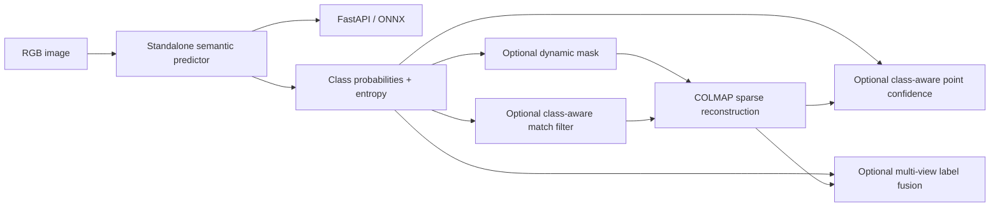
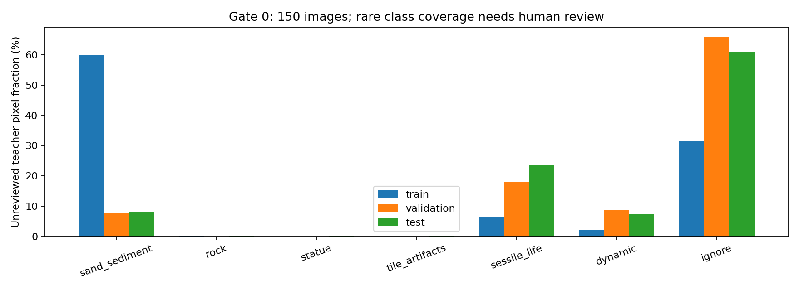
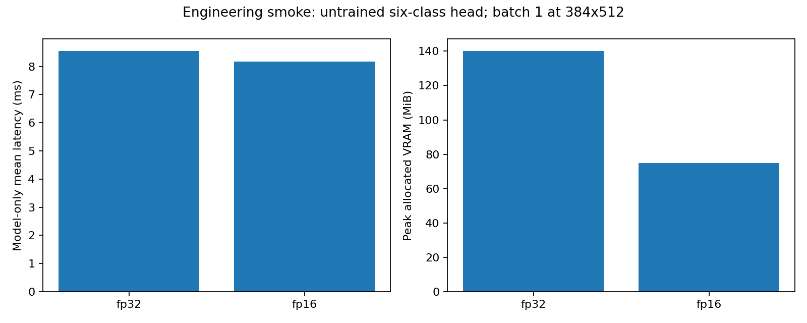

# Project summary v2: modular semantic perception

## Current outcome

v2 adds an optional semantic perception package and independently callable adapters for matching, 3D confidence and semantic sparse clouds. Grounding DINO + SAM proposals were actually generated on 150 spatially stratified images. Sixty hand-label tasks with teacher suggestions and eight delayed repeat tasks are ready. **No Mermaid segmentation student has been trained**, because the specification requires a human Gate 0 pass and hand-label evaluation. The current teacher fails to provide substantial rock/statue/tile coverage; training without reviewing that failure would undermine the experiment.

Original v1 reports/results are preserved. Code/configuration is extended directly. New artifacts use v2 names. Detailed human instructions are in [docs/annotation_guide_v2.md](docs/annotation_guide_v2.md); dataset/model cards are [docs/dataset_semantic_v2.md](docs/dataset_semantic_v2.md) and [docs/model_card_semantic_v2.md](docs/model_card_semantic_v2.md).

## Standalone architecture and detachable integration



The segmentation model, trainer, inference/cache and serving modules do not depend on COLMAP. Probability sampling, dynamic masking, class features, robust loss, conformal quantiles and voting expose array-level functions. Reconstruction-specific operations live in adapters and import COLMAP only where needed. A component can be called directly from Python or a CLI without running the full reconstruction pipeline.

`features/store.py` accepts an optional semantic provider while preserving its v1 cache. `matching.semantic_features=off` selects 12-input v1 models; compact adds four values (16 total); full adds both six-class vectors as well (28 total). Checkpoint feature versions and segmentation hashes are checked. Masking filters every aligned keypoint array before matching/database import and preserves original feature indices as provenance. Semantic voting and semantic confidence have independent reconstruction switches.

## Gate 0: actual measurements, provisional decisions

The audit contains 150 images, 50 per train/validation/test slab. All quantities below are unreviewed teacher proposals.

| Teacher class | Pixel share across sample |
| --- | --- |
| sand_sediment | 25.1582% |
| rock | 0.0630% |
| statue | 0.0186% |
| tile_artifacts | 0.0256% |
| sessile_life | 15.9700% |
| dynamic | 6.0102% |
| ignore | 52.7545% |

The teacher proposes dynamic objects in **105 images** and **224 instances**. These are not confirmed fish/diver counts. Among 38,926 audited-image endpoints in the v1 top-1 candidate arrays, **8.52%** fall in proposed dynamic masks. This is a partial-coverage estimate, not the fraction of all accepted SfM matches and not a proven upper bound on improvement.



Human review must distinguish genuine rarity from teacher failure, decide merges/ignore classes, and count real dynamic instances. Detector eligibility is undecided. The conditional YOLO script refuses to run unless reviewed counts pass the specified gate. The current gate file says `pending`, and criteria are pre-registered but intentionally **not frozen** before that review. A failed class-separability review stops training.

## Labels and leakage controls

The v1 partition remains 226 train, 65 validation, 743 test and 210 excluded views with a 0.4472-unit gap. There are 20 validation tasks, 40 test tasks and eight repeat tasks. At report generation, **0 hand masks are reviewed**. The editor stores real annotator/date/pass metadata and checks the 48-hour repeat delay. Suggestions are kept separately; they cannot become reviewed without an explicit human save. Frozen manifests and masks are content-verified.

Final segmentation evaluation only accepts hand labels. Validation selects checkpoints, temperatures and dynamic thresholds. Test images never fit them. Three descriptive sub-blocks in the 40 test tasks do not equal three rotated folds. Rotated-fold plans require sufficient independently reviewed masks in every fold and retrain all learned components. The camera-center/visible-surface leakage caveat still applies.

## Learning and statistical tools implemented

SegFormer B0, frozen DINOv2 linear probe and light decoder wrappers are available. Training includes AdamW, CUDA AMP, cosine scheduling, label smoothing, ignore pixels, underwater color/contrast/blur/crop/flip augmentation and correctly averaged gradient accumulation. Validation temperature scaling and pixel ECE are implemented. Teacher abstention on a hand-labeled pixel counts as an error.

Class-aware match training uses reference-F labels and the original spatial procedure. MLP/context compact/full ablations retain the v1 proposal population. Evaluators report AP, ROC AUC, precision/recall/F1, per-predicted-class regions and paired pair-bootstrap differences. Dynamic-mask evaluation requires hand-confirmed dynamic pairs. It compares none/teacher/student on fixed proposals; end-to-end variants rerun SfM separately.

Point confidence adds dominant-class one-hot, observation agreement, mean entropy and maximum dynamic probability (17 total inputs). Multiple held-out projections supply median reference reprojection targets. No held-out coordinates, quality, DINO or segmentation values enter features. Student-t or Huber loss replaces Gaussian NLL. Validation tracks are split into **model-selection and conformal-calibration groups**; repeated holdouts remain grouped. The v1 eight-input Gaussian architecture is retrained on the same tracks for a fair fold baseline. AUSE, Spearman, MAE, interval coverage, per-class errors and paired track-bootstrap differences are implemented. Exchangeability and reference-pose limitations remain.

Semantic voting exports label, agreement, class probabilities and point IDs in PLY/NPZ. Its evaluator excludes every observation from the held-out image before fusion and compares to that image's hand mask. Image-level bootstrap gives accuracy and per-class recall intervals. Dense masked MVS and semantic meshes are outside scope.

## Before/after compatibility measurement

The actual 16-image v1 context reconstruction was rerun after integration with semantic features disabled.

| Measure | Preserved v1 | Updated code, semantic off |
| --- | --- | --- |
| Cameras | 16 | 16 |
| Sparse points | 1890 | 1890 |
| Reprojection error px | 0.4504205128 | 0.4504205128 |

Those values agree exactly. This demonstrates compatibility of the detachable adapter; it does **not** show a semantic reconstruction improvement. v2 E1-E6 quality results and Q1-Q5 are pending hand labels. The old 16-image region remains development data already inspected.

## Deployment verification

ONNX export, CPU ONNX inference, PyTorch inference, image API, health endpoint and Docker packaging are implemented. A smoke run used the real pretrained MIT-B0 encoder with an **untrained** six-class head. Maximum ONNX/PyTorch logit difference was **1.69e-07**, below atol 1e-4 / rtol 1e-3; dynamic batch was checked.

On the RTX 4060 Laptop GPU, model-only mean latency was 8.55ms FP32 and 8.18ms FP16 at batch 1, 384x512, five warmups and twenty repetitions. These engineering smoke timings exclude image processing/API overhead and are not trained-student deployment results. The normal predictor rejects smoke checkpoints. Docker is supplied but has not been built/launched on this machine.



## How to continue

```powershell
# Human audit and hand-label editor
.\.venv\Scripts\python.exe scripts/serve_label_review.py
# After all human audit reviews, with explicit rare-class decisions:
.\.venv\Scripts\python.exe scripts/finalize_semantic_protocol.py gate --class-decisions '<reviewer JSON>'
# Generate train masks only after the gate passes
.\.venv\Scripts\python.exe scripts/make_pseudo_labels.py
# After 60 hand tasks and the eight delayed repeats
.\.venv\Scripts\python.exe scripts/finalize_semantic_protocol.py labels
# Train a standalone student
.\.venv\Scripts\python.exe scripts/train_segmentation.py
# Optional reconstruction adapter
.\.venv\Scripts\python.exe scripts/run_experiment.py experiment=semantic_matches data.image_list=configs/evaluation_images.txt run_name=semantic_development_v2
```

The adapter example additionally requires a trained semantic filter from `train_match_filter.py --semantic-features compact --semantic-checkpoint ...`. `run_semantic_ablation.py --plan-only` creates a reviewable command plan; execution refuses missing human prerequisites. `--fold-manifests` takes three genuinely separate frozen label manifests. Serving can load either `--checkpoint` or `--onnx` with export metadata. For reuse, import `SemanticPredictor`, `sample_probabilities`, `mask_keypoints`, `point_class_features` or `fuse_probabilities` directly.

Local verification: **62 tests passed**, Ruff and Black passed. Tests include ignore handling, human-manifest guards, dynamic/static masking, endpoint symmetry, contextual permutation equivariance, checkpoint hashes, held-out exclusion, conformal quantiles, teacher abstention, API errors, repeat delay, three-block separation, ONNX parity/dynamic batch and cache identity. Raw measurements are consolidated in `outputs/comparison_v2/comparison_v2.json`.

No CV performance claims are supplied before measured hand-label results. The next substantive step is human Gate 0 review, especially the teacher's rare-class failures, followed by corrected labels and final experiments.
