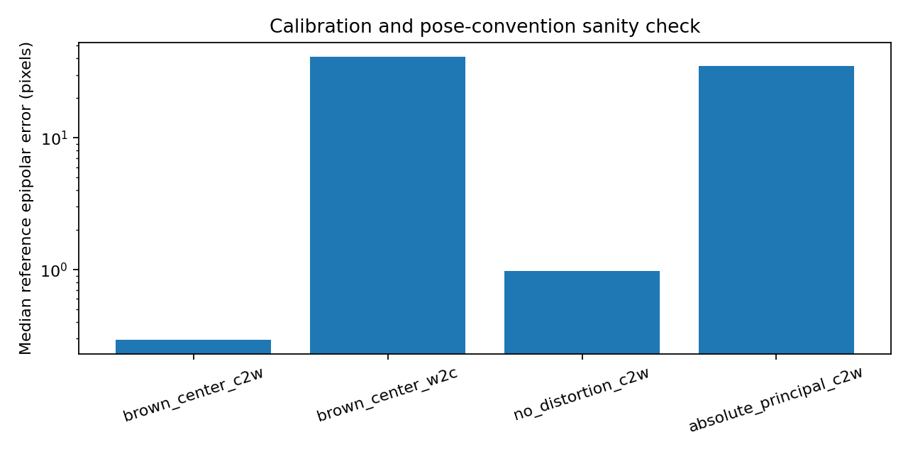
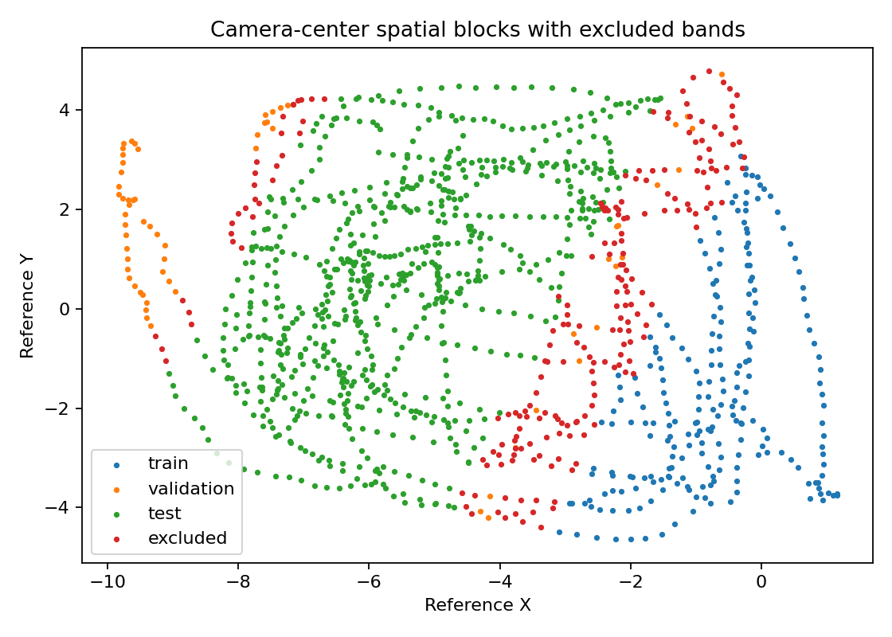
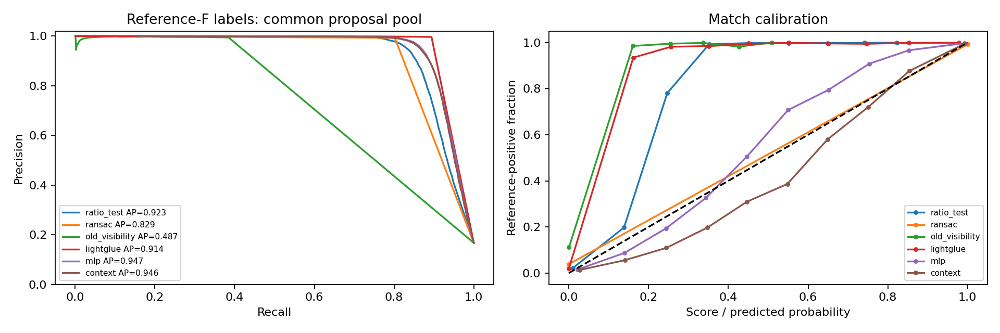
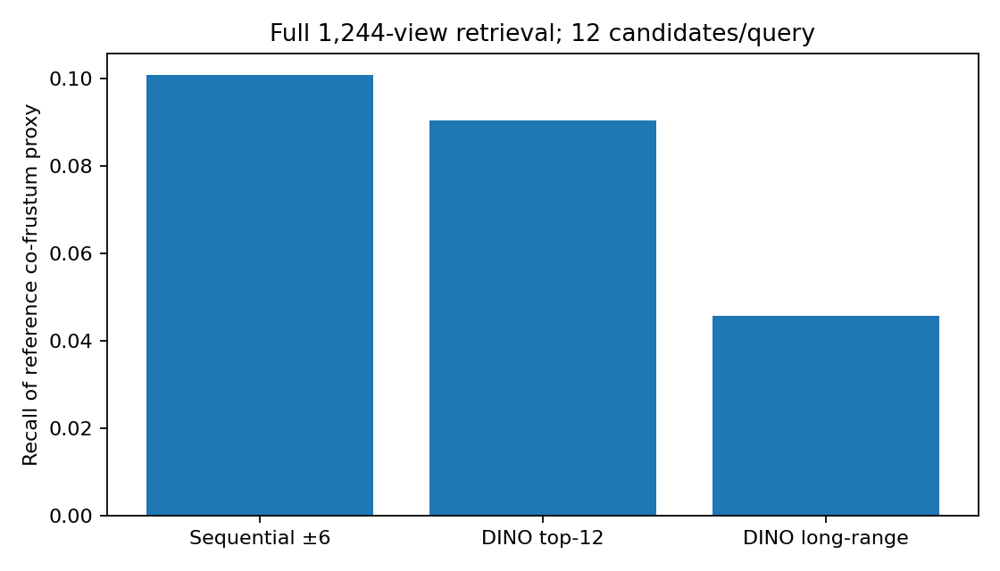
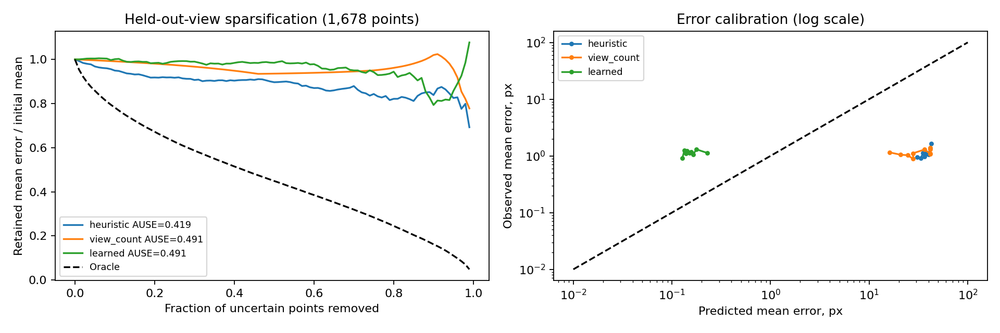
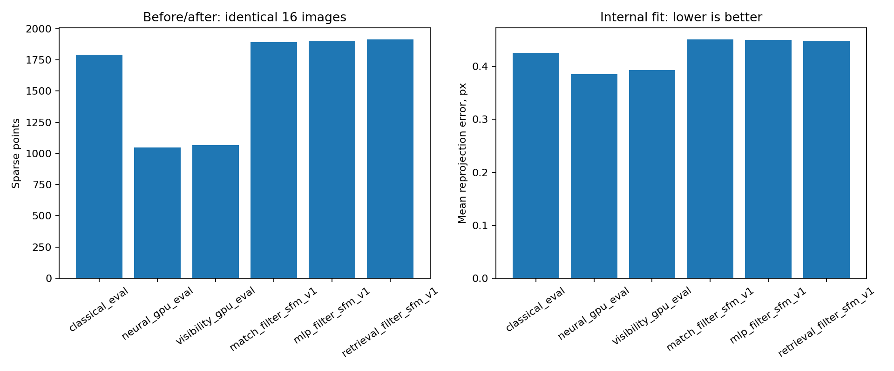

# Research report v1 — reference-supervised learning and independent component checks

This version adds three learned components and compares them with the original system. Original reports, summary and result directories remain unchanged. Code and configuration files are updated directly. All new experiment directories and this report carry `v1`.

The original detailed overview remains in [PROJECT_SUMMARY.md](../PROJECT_SUMMARY.md). The current component measurements are saved in `outputs/comparison_v1/comparison_v1.json`.

## Executive assessment

Reference geometry passes a distributed calibration/pose sanity check. Learned match scoring improves AP/ROC AUC over ratio scoring on the spatial development holdout and restores sparse support compared with the former fused-descriptor visibility pipeline. It still raises reprojection error relative to the original baselines. Global DINO retrieval finds long-range candidates, but its overall overlap-proxy recall is below the sequential baseline at equal query budget. Learned point-error prediction is operational and independently measured; its present AUSE and interval coverage do not establish an improvement over heuristic confidence.

## Step 0: reference-camera geometry gate

All 1,244 published poses enter the spatial partition and retrieval geometry. The audit samples 128 pairs distributed over the full acquisition and checks 11,938 mutual, tight-ratio SIFT matches without estimating a RANSAC model. Reference F is computed for every subsequently labeled pair and all 10,306 retrieved unique pairs.

For camera-to-world poses, relative geometry is `inverse(T_b) @ T_a`, `E = skew(t) @ R`, and `F = inverse(K_b).T @ E @ inverse(K_a)`. Observed coordinates are Brown-undistorted before reference epipolar error is evaluated. The implementation supports both OpenCV 4 and OpenCV 5 iterative-undistortion interfaces.

| Convention | Median px | Fraction <=1.5px |
| --- | --- | --- |
| brown_center_c2w | 0.2934 | 94.14% |
| brown_center_w2c | 41.3848 | 3.07% |
| no_distortion_c2w | 0.9818 | 65.70% |
| absolute_principal_c2w | 35.1153 | 2.45% |


The gate requires at least 1,000 audited matches, median error <=1.5px and >=60% below 1.5px. Nominal median error is 0.2934px and the passing fraction is 94.14%. The large errors under inverse-pose and absolute-principal-point alternatives support the selected conventions.

Epipolar compatibility is a necessary geometric condition, not proof that a correspondence is correct. Published poses were fitted by BA on the dataset; they provide supervision independent of this project's RANSAC, not independently surveyed ground truth. The sanity check establishes consistency with the recorded assumptions, not a complete physical validation of underwater calibration.



## Spatial partitions and leakage controls

The partition uses reference-camera position projected onto the principal scene axis. The original evaluation images anchor a test interval. Excluded bands separate test, training and validation regions. Counts are 226 train, 65 validation, 743 test and 210 excluded views; the spatial gap is 0.4472 reference units. Training selects 64 train and 32 validation views; the original 16-image list is used for the development comparison.

Camera-center separation does not guarantee disjoint visible surfaces. This limitation is retained explicitly. The 3D-confidence dataset additionally partitions triangulated reference XYZ: points outside their assigned spatial block are excluded. Normalization uses training data; model selection, probability temperature and decision threshold use validation. No model is fitted to test labels.

The 16-image region was already examined in the original project. These are spatial development holdout results, not a newly collected blind final benchmark. Multiple held-out scene regions and repeated seeds remain necessary.



## A: learned correspondence filtering

Input per top-1 RootSIFT candidate comprises descriptor distance, nearest-neighbor ratio, mutuality, DINO cosine, endpoint image quality, normalized endpoint coordinates and displacement (12 values). Candidates are generated before ratio filtering so the learner sees negative proposals.

Reference-F error <=1.5px is a positive compatibility label; error >=4px is negative. The ambiguous band is excluded from the loss and metrics. Training has 115 pairs; validation has 56 pairs. Evaluation has 75 pairs and 82,500 known common-pool labels.

Both an independent-match MLP and a custom contextual attention network are implemented. The context model pools the complete pair into eight latent tokens and attends back to each match, preserving permutation equivariance while avoiding a full quadratic match-attention matrix. This is a compact custom model inspired by contextual correspondence filtering, not a reproduction of OANet.

Training uses BCE, AdamW, 20 epochs, gradient clipping and seed 42. Temperature and the F1 operating threshold are fitted only on spatial validation. The context architecture is selected by validation AP; its threshold is approximately 0.8274. The MLP remains an ablation even though its test AP is slightly higher.

| Method | AP | ROC AUC | Precision | Recall | F1 |
| --- | --- | --- | --- | --- | --- |
| ratio_test | 0.9233 | 0.9573 | 0.9630 | 0.8213 | 0.8865 |
| ransac | 0.8292 | 0.9003 | 0.9927 | 0.8019 | 0.8871 |
| old_visibility | 0.4873 | 0.6930 | 0.9944 | 0.3842 | 0.5542 |
| lightglue | 0.9141 | 0.9487 | 0.9957 | 0.8978 | 0.9442 |
| mlp | 0.9473 | 0.9725 | 0.9835 | 0.8360 | 0.9037 |
| context | 0.9459 | 0.9722 | 0.9914 | 0.8067 | 0.8896 |


AP is average precision, and AUC is ROC AUC. Ratio and old heuristic scores are ranking baselines rather than calibrated probabilities. The old-visibility row evaluates its fixed fusion/quality scoring before custom weighted RANSAC. The full old reconstruction is compared below using preserved artifacts. LightGlue uses official pretrained SIFT weights and the same keypoints, RootSIFT descriptors, scales and orientations. Its source revision is pinned to `eb42fee2d71449efb0aa5c10549752b5d75384d8`.

All aligned metrics share the RootSIFT top-1 proposal pool. LightGlue or fused matches outside this pool are excluded from aligned PR/AUC; LightGlue's native accepted-match precision is recorded separately. Different proposal coverage must be considered when reading these rows. LightGlue achieves the strongest common-pool F1 here; the custom networks have stronger score-ranking AP/AUC.

The new SfM path applies learned probability thresholds and resolves competing feature assignments. It does not use fixed descriptor fusion alpha or the custom weighted RANSAC. COLMAP then performs its standard verification and BA. Probability changes which matches enter COLMAP; its BA objective remains unweighted.



## B: DINO global retrieval

Frozen B/14 CLS descriptors are extracted at a longest edge of 336px for all 1,244 images. Cosine retrieval selects 12 neighbors per query, yielding 10,306 unique pairs. Inference uses images only. Reference poses are used afterward for evaluation, never as retrieval features.

Reference poses alone cannot determine true overlap without scene depth, relief and occlusion. The current evaluator therefore reports a **co-frustum proxy**: a 5x5 view grid at median reference-triangulated depth (2.8184 reference units), with reciprocal in-frustum coverage >=25%. Six sensitivity settings vary depth by factors 0.5/1/2 and overlap threshold 25%/50%.

At the equal nominal budget of 12 candidates/query, sequential ±6 recall is **10.08%** and DINO top-12 recall is **9.04%** against the default proxy. DINO long-range recall is **4.58%** for positive pairs separated by more than six indices; that candidate class is absent from the sequential window. Default DINO proxy precision is **87.06%**. There are many proxy positives per query, so recall is budget-limited and strongly dependent on assumed depth.

The recommended experimental option is hybrid retrieval plus sequential edges. On the original 16 images it supplies 114 pairs instead of 75; this has a larger pair budget, so it is not an equal-cost comparison. A full-scene SfM benchmark has not been run in this revision. Full-scene global retrieval and its candidate/reference-F graph have been completed.



## C: learned point error and confidence

The point learner predicts a Gaussian distribution for `log1p(held-out reprojection error)`. Inputs describe observed-view count, triangulation angles, training-view fit error, endpoint quality and DINO consistency/variation across the observed track. Track length and unique view count coincide for these conflict-free tracks, so they are represented by a single count feature.

For each track, a deterministic view is held out. The point is retriangulated with published cameras using the remaining views only. The held-out measurement supplies the target error. Its coordinates, descriptor and quality never enter learner inputs; a regression test verifies this exclusion. Training/validation tracks are constructed with ratio matching and RANSAC, but the target is measured with reference cameras and the excluded view, rather than copying a RANSAC mask or fitted-view residual.

After geometry/spatial exclusions, the dataset has **260 train, 127 validation and 1,678 test points**. Test tracks come from the original classical reconstruction, holding the point population fixed for comparing confidence methods. Geometry-invalid and spatially excluded counts are recorded, not silently counted as correct.

The MLP is 8->48->32->2 with GELU. Training uses 150 epochs, AdamW and log-error Gaussian NLL. A scale is fitted on validation only. Heuristic and view-count baselines receive validation-only error-unit scaling for calibration/MAE; their ranking is unchanged by that scaling.

| Method | AUSE ↓ | Spearman(error) ↑ | Error MAE px |
| --- | --- | --- | --- |
| heuristic | 0.4194 | 0.1896 | 36.6046 |
| view_count | 0.4907 | 0.0675 | 30.9529 |
| learned | 0.4910 | 0.0325 | 0.9859 |


Lower AUSE and higher Spearman(error) are preferable. Sparsification removes the points with highest predicted uncertainty first. Curves show retained mean error normalized by the initial mean. AUSE integrates its difference from an oracle over removal fractions 0 to 0.99. Tied uncertainties are averaged within groups, so the view-count baseline cannot gain from favorable input ordering.

The learned model currently has **AUSE 0.4910**, worse than the heuristic's **0.4194**. Its nominal 90% interval covers only **36.59%** of test errors. This is evidence against claiming calibrated uncertainty or superior ranking in v1. Mean held-out test error is 1.1386px and the median is 0.8715px.

Validation contains extreme error outliers (maximum about 3,083px), while the test maximum is about 9.74px. This distribution shift and limited training support strongly affect NLL/scale fitting. They also explain why least-squares-scaled simple baselines have poor error-unit MAE despite more useful rankings. Robust calibration, better-supported training tracks and additional spatial blocks are priorities.

Production confidence export uses estimated SfM cameras, observed descriptors and quality only; reference poses are not used for prediction. The combined v1 reconstruction has learned confidence/error/interval fields for all 1,912 sparse points. These outputs remain experimental evidence scores.



## Before/after SfM on identical input

All rows use the original 16 images, 960x720 resolution, seed 42 and the same calibration/mapper settings. The first three rows are preserved pre-change runs. New rows use learned probability filtering. Only the combined row changes pair selection to hybrid.

| Run | Cameras | Points | Reprojection px | ATE reference units |
| --- | --- | --- | --- | --- |
| classical_eval | 16 | 1790 | 0.4259 | 0.01043 |
| neural_gpu_eval | 16 | 1047 | 0.3849 | 0.01146 |
| visibility_gpu_eval | 16 | 1065 | 0.3933 | 0.01090 |
| match_filter_sfm_v1 | 16 | 1890 | 0.4504 | 0.01078 |
| mlp_filter_sfm_v1 | 16 | 1897 | 0.4497 | 0.01093 |
| retrieval_filter_sfm_v1 | 16 | 1912 | 0.4474 | 0.01080 |


Context filtering on the unchanged 75-pair window increases sparse support from 1,065 to 1,890 points versus old visibility (about +77.46%), and from 1,790 to 1,890 versus classical (+5.59%). Mean reprojection error rises to 0.4504px. Hybrid retrieval adds 22 more points (1,912 total) and slightly lowers that internal error to 0.4474px. All variants retain 16 cameras. Neither result establishes dominant geometric accuracy.

No new dense MVS claim is made: these v1 runs stop at sparse reconstruction and learned point confidence. The existing dense clouds/meshes are retained. The v1 path still supports optional dense processing.



## Reproduction and artifacts

Install the research extra with `python -m pip install -e ".[neural,research,dev]"`. The optional LightGlue baseline also needs Kornia and the pinned official LightGlue source. In the prepared environment both are installed and pretrained SIFT LightGlue weights are cached.

```powershell
.\.venv\Scripts\python.exe scripts/audit_reference.py
.\.venv\Scripts\python.exe scripts/retrieve_pairs.py
.\.venv\Scripts\python.exe scripts/train_match_filter.py
.\.venv\Scripts\python.exe scripts/evaluate_match_filter.py
.\.venv\Scripts\python.exe scripts/train_point_confidence.py
.\.venv\Scripts\python.exe scripts/run_experiment.py experiment=learned_matches data.image_list=configs/evaluation_images.txt matching.pairing=hybrid reconstruction.learned_confidence_checkpoint=outputs/point_confidence_v1/error_model_v1.pt run_name=new_combined_v1
```

Existing reports/runs are immutable. For a fresh complete run under a new root, use `scripts/run_research_suite.py --output outputs/reproduction_v1`. It generates a fresh classical baseline for confidence test tracks, runs the reference audit before supervision, and selects the filter by spatial validation. Add the optional LightGlue dependencies before running the suite.

Key new files are `geometry/reference.py`, `data/spatial.py`, `features/store.py`, `retrieval/pairs.py`, `matching/learned_filter.py`, `matching/lightglue_adapter.py`, `pointcloud/learned_confidence.py`, `evaluation/uncertainty.py` and `research_pipeline.py`. The old runner dispatches the new method through `experiment=learned_matches`, preserving the classical/old-visibility paths.

`matching.evaluation_mode=true` rejects trained/validation images and cameras outside the test slab. Set it to false only for an explicitly labeled production reconstruction; overlap with training images is recorded and those results are not spatial-holdout evaluation. Learned filtering currently requires the training preprocessing: 960px, 4,096 requested SIFT features and no CLAHE.

Local validation passes **35 pytest cases**, including reference-F/triangulation geometry, ambiguous-label exclusion, attention permutation equivariance, holdout isolation, spatial gaps, tie-aware AUSE, unique assignments and retrieval pair validity. Ruff and Black check the updated code. Raw artifacts remain under the new versioned output directories; six report figures live under `docs/figures_v1`.

## Research priorities

The immediate priority is improving C's training support and error-distribution robustness, followed by multiple spatial point blocks and uncertainty calibration. A needs evaluation on additional unseen scene regions and fair end-to-end comparison with LightGlue. B needs overlap labels supported by a scene model or observed shared tracks, followed by a budget-matched hybrid evaluation. Repeated seeds and the full-scene reconstruction remain separate benchmark work.

The new supervision is independent of this project's RANSAC decision rule. Establishing independent measured geometric truth remains an additional requirement. The evidence supports a more testable learned pipeline and increased sparse support; it does not yet support a claim of universally better reconstruction or calibrated 3D confidence.

## Primary methodological references

- [OANet paper](https://arxiv.org/abs/1908.04964): contextual correspondence classification motivates the custom pair-context architecture.
- [Official LightGlue implementation](https://github.com/cvg/LightGlue): pinned pretrained SIFT comparison baseline.
- [Ilg et al., uncertainty evaluation](https://arxiv.org/abs/1802.07095): sparsification/oracle comparison motivates the explicitly specified AUSE implementation.
