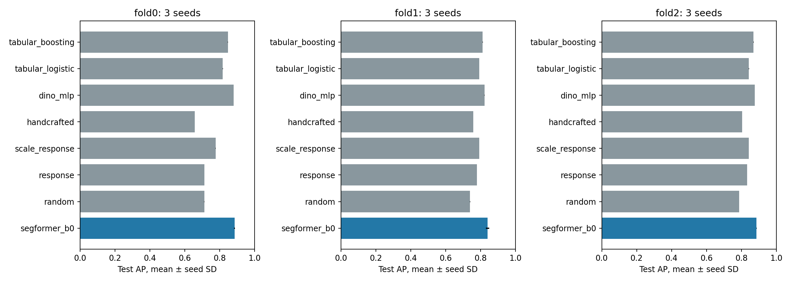
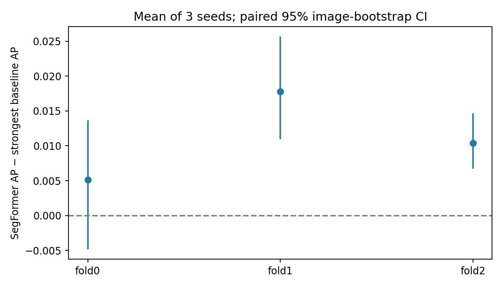
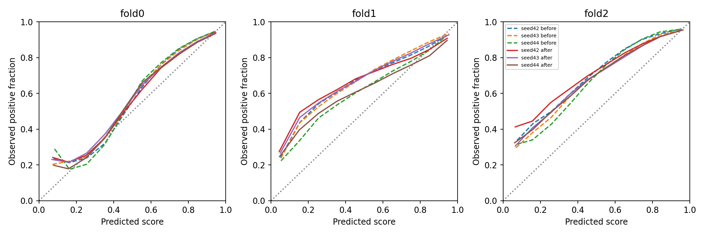
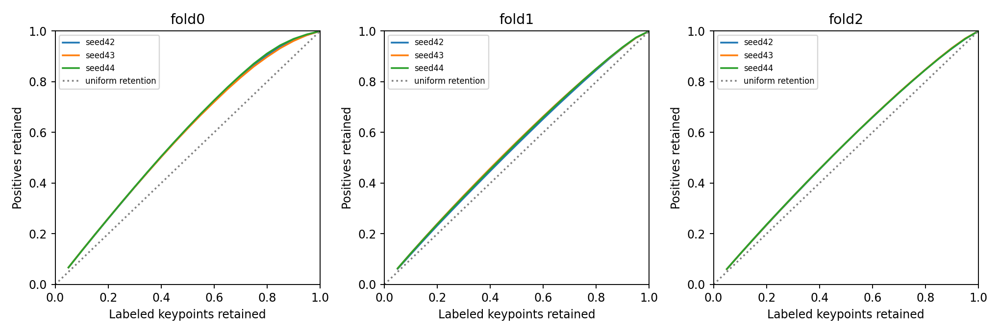

# SegFormer-B0 three-fold benchmark v3

Completed primary dense-matchability E1/E3: **3 spatial folds × 3 seeds**, with all seven controls evaluated on each matching fold/seed; trainable controls are refitted on that fold?s training views. Four-epoch budgets, labels, thresholds and spatial partitions are unchanged. Two completed fold0 SegFormer and two baseline runs were reused after verifying configurations, dataset/model hashes and prediction populations. The interrupted seed44 was rerun in a new directory. Old results/reports remain preserved.

## Pre-registered outcomes

Q1: **met**, positive paired-CI regions: ['fold1', 'fold2']; required at least two of three. Q2: **not_met**, requiring ECE ≤0.05 for every seed of each region. The exact failing seeds are recorded in the comparison JSON. Q3/Q4/Q5 are not evaluated by this run; the earlier negative/partial filter and confidence results remain separate evidence.

## Per-seed test results

| Fold | Seed | AP | ROC AUC | ECE after | Brier after |
| --- | --- | --- | --- | --- | --- |
| fold0 | 42 | 0.884234 | 0.783489 | 0.047924 | 0.162468 |
| fold0 | 43 | 0.882831 | 0.776936 | 0.057485 | 0.166926 |
| fold0 | 44 | 0.888155 | 0.792396 | 0.052903 | 0.158941 |
| fold1 | 42 | 0.830307 | 0.650268 | 0.125579 | 0.204475 |
| fold1 | 43 | 0.847265 | 0.675048 | 0.148163 | 0.205047 |
| fold1 | 44 | 0.843610 | 0.669163 | 0.063849 | 0.184413 |
| fold2 | 42 | 0.885566 | 0.694141 | 0.179275 | 0.191319 |
| fold2 | 43 | 0.888104 | 0.699608 | 0.150594 | 0.179230 |
| fold2 | 44 | 0.887227 | 0.697758 | 0.153240 | 0.180722 |

## Comparison with the strongest controls

| Fold | SegFormer mean AP | Strongest control | Control mean AP | AP difference | Paired 95% CI |
| --- | --- | --- | --- | --- | --- |
| fold0 | 0.885073 | dino_mlp | 0.879971 | 0.005102 | [-0.004756793678706134, 0.013552226608275722] |
| fold1 | 0.840394 | dino_mlp | 0.822597 | 0.017796 | [0.011027164608199544, 0.025558448147298168] |
| fold2 | 0.886966 | dino_mlp | 0.876570 | 0.010396 | [0.006791402928488562, 0.01457176072817178] |

The strongest control is selected by mean test AP across three seeds in that region, including tabular methods. CIs are conditional on this choice. The saved JSON additionally compares against the strongest tabular control and fixed DINO-MLP control. Each seed comparison uses identical original L1 test labels/keypoints and images, verified against immutable labels. No test labels fit model weights, temperature or normalization.

## Equal-weight summary across the nine runs

| Method | Mean AP | SD across fold/seed runs | Mean ROC AUC |
| --- | --- | --- | --- |
| segformer_b0 | 0.870811 | 0.023309 | 0.715423 |
| random | 0.746175 | 0.033243 | 0.500002 |
| response | 0.774596 | 0.051682 | 0.559973 |
| scale_response | 0.803721 | 0.029612 | 0.608598 |
| handcrafted | 0.739677 | 0.065533 | 0.478597 |
| dino_mlp | 0.859713 | 0.027884 | 0.701409 |
| tabular_logistic | 0.817365 | 0.021919 | 0.629143 |
| tabular_boosting | 0.842774 | 0.024824 | 0.666742 |

The SD combines region and seed variation; it is not a confidence interval. There are **three spatial regions in one scene**, not nine independent regions or three scenes. AP is average precision, not accuracy. All methods share each fold's same known-label population. Fold prevalences differ, so paired within-fold differences are the primary comparison.

## Calibration before/after validation-only temperature

| Fold | Seed | Temperature | ECE before | ECE after | Brier before | Brier after |
| --- | --- | --- | --- | --- | --- | --- |
| fold0 | 42 | 0.846554 | 0.069863 | 0.047924 | 0.165274 | 0.162468 |
| fold0 | 43 | 0.905362 | 0.065460 | 0.057485 | 0.168387 | 0.166926 |
| fold0 | 44 | 0.819031 | 0.076849 | 0.052903 | 0.162397 | 0.158941 |
| fold1 | 42 | 0.831460 | 0.137865 | 0.125579 | 0.204279 | 0.204475 |
| fold1 | 43 | 0.887959 | 0.153991 | 0.148163 | 0.205055 | 0.205047 |
| fold1 | 44 | 0.819216 | 0.061942 | 0.063849 | 0.183627 | 0.184413 |
| fold2 | 42 | 0.769414 | 0.196768 | 0.179275 | 0.195168 | 0.191319 |
| fold2 | 43 | 0.899102 | 0.160211 | 0.150594 | 0.181144 | 0.179230 |
| fold2 | 44 | 0.715088 | 0.181354 | 0.153240 | 0.187927 | 0.180722 |

Temperature is fitted on spatial validation only, after validation-AP checkpoint selection. Useful ranking and calibrated probabilities are separate findings. If Q2 fails, describe predictions as matchability scores rather than universally calibrated probabilities.

## Figures and reproducibility

Comparison: `outputs\segformer_folds_v3\comparison_v3\comparison_v3.json`. Run/source/criteria/dataset hashes and reused run references: `outputs/segformer_folds_v3/fold_manifest_v3.json`. Binned contrast, scale, sharpness, brightness and frame-radius results are saved for seed42 in each fold. Paired differences use 500 exact weighted-AP image-cluster resamples, aligned across three seeds before averaging. They condition on the fixed regions; nearby images and shared surfaces can remain correlated, so the image bootstrap may understate broader spatial uncertainty. New-scene generalization is unmeasured.

## Remaining scope

This completes the requested three-fold **SegFormer matchability** comparison. It does not complete downstream filter/point-confidence folds, L2/soft training, new SfM/MVS comparisons or deployment latency. Labels describe RootSIFT/top1 epipolar compatibility using published BA cameras, not independently surveyed match truth. Spatial camera gaps do not ensure disjoint surfaces. Sparse supervision does not validate every pixel or another detector/scene. Refraction remains unmodeled. Four epochs are the fixed comparison budget and do not establish convergence.

This reviewed report preserves the automatically generated `segformer_folds_report_v3.md`; the clarification distinguishes refitting learned controls from reevaluating fixed controls. Numerical results and figures are unchanged.
